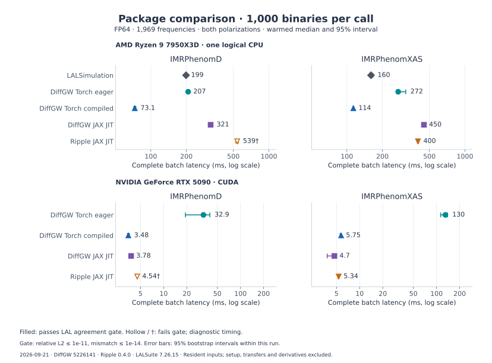

# DiffGW compared with related packages

DiffGW brings gravitational-wave models into **native PyTorch and JAX** workflows.
Its waveforms are tensors that can be batched over binaries, compiled for repeated
evaluation, and differentiated through supported waveform and analysis paths.
The same package includes detector projections, likelihoods and Fisher tools,
so waveform generation can stay inside the framework used for inference.

This page explains how that design compares with LALSimulation, Ripple,
PhenomXPy and GWFAST, and where DiffGW's model implementations differ.

## What DiffGW provides

- **Two native backends.** `torchwave` and `jaxwave` share an analytical physics
  core and expose corresponding waveform APIs. The unified `diffgw` interface
  selects either backend, so PyTorch and JAX users can work with familiar tensor
  and differentiation tools.
- **Batched, compiled evaluation.** Parameters for multiple binaries become
  waveform arrays of shape `(B, N)`. Supported paths use `torch.compile` or
  `jax.jit`, with broadcasting and JAX `vmap` for vectorization. CPU and CUDA
  performance is measured [below](#measured-batch-performance).
- **Waveforms connected to analysis.** Detector responses, noise PSDs, Whittle
  and relative-binning likelihoods, and forward-mode Fisher calculations are
  available alongside waveform generation. The tutorials demonstrate
  [Fisher analysis](tutorials/02_fisher_analysis.md) and
  [gradient-based inference](tutorials/03_parameter_estimation_nuts.md).
- **Frequency- and time-domain models.** The catalogue spans post-Newtonian,
  phenomenological, tidal, precessing and higher-mode models, with native
  time-domain IMRPhenomT, EOB implementations and Kerr ringdown tools. The
  [model notes](#model-specific-differences-from-lal) identify each family's
  calibration and validation scope.

DiffGW's code is MIT-licensed. The native waveform implementations run without
LAL; optional black-box LAL comparisons provide reference checks. Installation
can select [PyTorch, JAX or both](usage.md), with
[external ROM data](external-data.md) acquired separately where required.

## How DiffGW differs

| Related package | Common ground | DiffGW's approach |
| --- | --- | --- |
| **[LALSimulation](https://lscsoft.docs.ligo.org/lalsuite/7.26/lalsimulation/index.html)** | Established waveform families and reference conventions. | Native tensor implementations make batching and automatic differentiation part of waveform evaluation. LAL supplies compiled C routines with Python bindings; its waveform API does not document a general native PyTorch/JAX autodiff interface. DiffGW records numerical agreement and deliberate modeling differences per approximant. |
| **[Ripple](https://github.com/GW-JAX-Team/ripple)** | Differentiable JAX waveforms, JIT compilation and vectorization. | DiffGW provides a PyTorch implementation alongside JAX, plus native time-domain IMRPhenomT, EOB and Kerr QNM tools. Ripple's [catalogue](https://gw-jax-team.github.io/ripple/stable/guides/catalogue/) includes frequency-domain CBC models with precessing higher modes and NRTidalv3 variants, as well as burst and pulsar models; the catalogues overlap without being identical. |
| **[PhenomXPy](https://gitlab.com/imrphenom-dev/phenomxpy)** | Native time-domain PhenomT physics and the authors' calibration and reconstruction formulas. | DiffGW integrates the model into both tensor backends, with shared time grids, batching and first-order derivatives. PhenomXPy documents the T/THM/TP/TPHM family using Numba on CPU and CuPy on GPU, with parallel evaluation over time samples; native PyTorch/JAX autodiff is not documented in its [package overview](https://pypi.org/project/phenomxpy/). |
| **[GWFAST](https://gwfast.readthedocs.io/en/latest/)** | Differentiable waveforms, detector responses, SNR and Fisher calculations. | DiffGW connects these calculations to its PyTorch and JAX waveform APIs and Bayesian likelihood tools. GWFAST focuses on detector-network and population forecasting, with JAX/analytical derivatives for native models and numerical waveform derivatives by default for its [external LAL/TEOB wrappers](https://gwfast.readthedocs.io/en/latest/waveforms.html). |

Derivative and compilation support is documented per DiffGW model. For example,
[native IMRPhenomT](imrphenomt.md) supports first-order derivatives on fixed
grids; higher-order derivatives through its frequency inversion are unsupported,
and automatic duration selection is an eager operation because it changes array
shape. The CPU/CUDA measurements below cover FP64 execution; MPS has precision
and compiler limitations, and no TPU measurements are reported here.

## Measured batch performance

DiffGW's batching advantage is visible in the
[FP64 package benchmarks](package_benchmarks.md): at **1,000 binaries**,
compiled PyTorch has the lowest measured CPU batch latency for both
IMRPhenomD and IMRPhenomXAS. The plot shows complete-batch median latencies
for that batch size, with **1,969 frequency bins and both polarizations**.
CPU results use one logical Ryzen 9 7950X3D CPU; GPU results use the same RTX 5090.

[](benchmarks/plots/package-latency-summary.svg)

Axes are logarithmic, with a shared scale within each hardware row. Error bars
are 95% bootstrap intervals within the recorded run on 21 September 2026;
they do not measure variation across machines or independent runs. Select the
plot to view it at full size. The
[batch-scaling plots](package_benchmarks.md#warmed-batch-latency) cover all four
batch sizes and include TaylorF2.

Filled markers pass the campaign's strict LAL reference gate; hollow markers
and † identify diagnostic timings that fail it. The gate requires
direct relative L2 at most `1e-11` and flat-weight, constant-phase-maximized
mismatch at most `1e-14`, for every binary and both polarizations. Across all
measured batches and devices, DiffGW passes for PhenomD and PhenomXAS, with
largest relative L2 errors of `9.21e-13` and `1.67e-13` respectively. LAL's
agreement with itself is a consistency check.

These are warmed waveform-generation timings with inputs already on the device;
they exclude transfers, setup and derivative evaluation. LAL has the lowest
single-waveform CPU latency for the three measured models. GPU results vary by
model, batch and backend. The full report retains all timings, uncertainty
intervals, adapter details and accuracy failures, including TaylorF2 results
that miss the strict gate. PhenomXPy and GWFAST are compared by capability here;
they were not timed in this campaign.

## Physics coverage and scientific agreement

DiffGW combines implementations of published waveform models with independently
calibrated components. For example, PhenomD and PhenomXAS closely reproduce the
tested LAL outputs, while the XHM/XPHM higher-mode ringdown uses independent
SXS-based fits. These distinctions are recorded in the
[model manifest](model_manifest.json) and
[provenance ledger](provenance_ledger.md), alongside reference versions, tested
configurations and unresolved cases.

DiffGW separates three kinds of validation:

| Check | Evidence it provides |
| --- | --- |
| **Torch/JAX agreement** | Consistency between DiffGW's two implementations for the tested inputs. |
| **Same-model reference agreement** | Agreement with a specified LAL or author implementation, using declared modes, conventions, grids and tolerances. |
| **Independent physical validation** | Agreement with NR or another independent physical reference over a stated test set. |

The checks serve different purposes: frontend agreement does not establish
physical accuracy, and a shared author calibration makes the PhenomXPy
comparison an implementation check. Reference results retain direct complex
errors and the definition of any phase/time alignment or mismatch weighting.
Gradient checks are separate from waveform-value checks.

## Model-specific differences from LAL

DiffGW implements waveform physics in its own tensor backends. The following
details explain how its coefficients, conventions, calibration and numerical
methods relate to LAL, and summarize the available reference evidence.

| Model or family | DiffGW implementation | Reference evidence |
| --- | --- | --- |
| **IMRPhenomD / IMRPhenomXAS** | Published models with explicit coefficient precision, reference-phase and time-origin conventions. XAS uses the author-supplied symbolic calibration deposit identified in the provenance ledger. | Both DiffGW frontends pass the strict LAL gate for all measured D/XAS configurations in the [FP64 campaign](package_benchmarks.md#accuracy-across-the-measured-configurations). |
| **IMRPhenomXP** | The documented clean path uses MSA version 223, `convention=1`, `final_spin_mod=3` and `phi0=0`. Nonzero `phi0` retains legacy geometry; unsupported cases use explicit fallback. | Frozen catalog and holdout cases agree closely. The manifest records residuals at exact alignment, zero spin and tiny in-plane spins, with detector-projection errors distinguished from polarization errors. |
| **IMRPhenomXHM / IMRPhenomXPHM** | Five modes: `(2,2)`, `(2,1)`, `(3,3)`, `(3,2)` and `(4,4)`. The four higher modes use independent SXS-based ringdown fits and native Kerr QNM calculations; XPHM adds precession to this carrier. | The calibration differs from LAL's. Recorded NR checks examine phase in a restricted ringdown band with reference amplitudes and affine phase alignment; they do not validate full-waveform amplitude and phase accuracy. |
| **SEOBNR_ODE / TEOBResumS** | Native EOB dynamics with continuous spline peak location and ringdown attachment, using their own modeling and numerical choices. | The manifest's LAL diagnostic cases have polarization relative L2 errors about 1.02 and 1.00 respectively, failing the reference checks. These implementations are not currently validated as LAL-equivalent. |
| **TaylorF2_HM** | Literature-based frequency-domain PN extension with eight leading-order modes through `l=4`: `(2,2)`, `(2,1)`, `(3,1)`, `(3,2)`, `(3,3)`, `(4,2)`, `(4,3)`, `(4,4)`. | The external TaylorF2 check covers `(2,2)`. An independent full-waveform reference for the higher modes, higher-PN completeness and spin-amplitude completeness remain unresolved in the manifest. |
| **SEOBNR_ROM** | Data-backed reduced-order evaluation; the chosen surrogate and calibration asset define the model. Official SEOBNRv4ROM data are external. | Validation applies to the selected asset. See [external data](external-data.md) for acquisition and [third-party notices](../THIRD_PARTY_NOTICES.md) for unresolved redistribution terms. |

The EOB [peak locator](../src/torchwave/approximants/eob/continuous_matching.py)
solves a natural cubic spline's derivative on accepted samples, selecting an
interior maximum and rejecting unresolved or tied maxima. The selected root is
locally differentiable, while interval and maximum selection remain piecewise;
continuous attachment does not remove integration-step dependence.
JAX's non-symmetric Kerr angular eigensolver uses a host CPU callback.

### Numerical precession: SpinTaylor and PNR

`IMRPhenomXPHM-SpinTaylor` (`prec_version=320`) integrates spin-precession
equations with fixed-grid RK4 in velocity space. `IMRPhenomXPNR`
(`prec_version=330`, `final_spin_mod=2`) combines NR-tuned PNR angles with
DiffGW's native XHM coprecessing carrier. The carrier, precession integration,
angle attachment and minimal-rotation quadrature contribute to differences from
LAL; comparisons specify the precession and tuned-coprecessing options.

The [SpinTaylor tests](https://github.com/xangma/diffgw/blob/5226141/tests/test_imrphenom_xphm_spintaylor.py)
and [PNR tests](https://github.com/xangma/diffgw/blob/5226141/tests/test_imrphenom_xpnr.py)
use optimized plus-polarization overlaps with model-specific tolerances.
Their scope differs from the direct, both-polarization FP64 gate above; these
variants were not timed in that campaign.

### Native IMRPhenomT family

`IMRPhenomT` evaluates the aligned-spin dominant `(2,±2)` time-domain model
from Estellés et al. (2021), using the authors' MIT-licensed phenomxpy
calibration and reconstruction release pinned in the provenance ledger.
The family also provides `THM`, `TP` and `TPHM`, with NNLO, MSA and numerical
precession for the latter two. All four have native time-domain evaluation;
there is no direct frequency-domain implementation.

The sampling wrapper places the amplitude peak at `tc`, with a shared fixed
grid for batches and explicit `duration`. It does not promise LAL's automatically
selected epoch or array length. `phic` fixes orbital phase at `f_ref`.
Optional black-box LAL comparisons and Torch/JAX tests accompany the
implementation; LAL is not a runtime dependency.

The [pinned author-reference test](https://github.com/xangma/diffgw/blob/5226141/tests/test_phenomt_reference.py)
checks both frontends for masses `(60, 6)` and aligned spins `(0.9, 0.1)` at
five dimensionless times. Frequency and amplitude use `rtol=1e-11` and
`atol=1e-13`; phase, after subtracting its value at time zero, uses
`rtol=1e-11` and `atol=1e-10`. This is an implementation check using shared
author calibration, rather than independent physical validation.

The optional LAL regression tests define the following acceptance criteria:

| Model | Cases and sampling | Direct complex relative L2 | Mismatch |
| --- | --- | ---: | ---: |
| T | Five mass/spin configurations; 2048 Hz | `< 1e-3` | `< 1e-6` |
| THM | Three configurations; 2048 Hz; five mode pairs | `< 1e-3` | `< 1e-6` |
| TP / TPHM, NNLO | Three configurations; 2048 Hz, except the mass-ratio-10 case at 32768 Hz | `< 1e-2` | `< 1e-4` |

These are **test thresholds**, not measured worst-case errors over the model's
domain. Each comparison uses LAL's returned time grid. Relative L2 applies no
time, phase or amplitude adjustment; mismatch uses an unweighted complex inner
product maximized over constant phase, without a time shift. Exact inputs are
retained in the T reference test and
[family reference tests](https://github.com/xangma/diffgw/blob/main/tests/test_phenomt_family_lal.py).
The NNLO tests select `PhenomXPrecVersion=10210` and `PhenomXPFinalSpinMod=0`,
which differ from LAL's default numerical precession.

NNLO reference agreement is sensitive to sampling, particularly for the rapidly
precessing mass-ratio-10 case. DiffGW anchors ringdown continuation at physical
time `tc`, independently of the requested sampling grid, and uses the published
orbital-angular-momentum series. Grid-invariance tests and the precession
conventions are documented in the [T-family guide](imrphenomt.md).

For the additional precession methods, the same `(40, 15)` generic-spin
case at 2048 Hz gives the following direct complex-strain errors against
LALSimulation 6.2.1. The angle and remnant-spin options are matched explicitly.
The [MSA receipt](validation/phenomt_precession_20260921.json) and updated
[numerical receipt](validation/phenomt_numerical_20260922.json) record the
environment and reproduction commands. Use
`python scripts/validate_phenomt_precession.py` for the baseline comparison.

| Method / LAL options | TP relative L2 | TPHM relative L2 | Largest mismatch |
| --- | ---: | ---: | ---: |
| MSA / `22310`, `FinalSpinMod=3` | 0.00379 | 0.00388 | 0.00000754 |
| Numerical / `300`, `FinalSpinMod=4` | 0.0234 | 0.0236 | 0.000274 |

These measurements use the full returned LAL time grid without time, phase,
or amplitude adjustment for relative L2. Numerical precession uses the
PhenomT frequency evolution, fixed intrinsic integration nodes, and a
physical-time ringdown boundary. It now excludes the N3LO quadratic-spin
terms according to the public `phenomtp` API specification, retaining the
leading self-spin terms and N4LO spin-orbit terms. This reduces the baseline
error from about 2.8% to 2.4%; it does not eliminate the reference differences.
The full published spin equations remain available in the internal helper.

Additional numerical cases at 2048 Hz give the following errors. Both native
backends are included in the receipt; their reported errors agree to the
displayed precision. The spins, viewing geometry, reference frequency, and
separate inspiral/ringdown metrics are recorded there.

| Numerical case | TP relative L2 | TPHM relative L2 | Largest mismatch |
| --- | ---: | ---: | ---: |
| Single-spin, masses `(35, 20)` | 0.0263 | 0.0264 | 0.000343 |
| Equal masses `(30, 30)` | 0.0174 | 0.0173 | 0.000148 |
| Strongly spinning, masses `(60, 6)` | 0.308 | 0.307 | 0.0475 |

The large 10:1 residual persists at 16384 Hz (TP relative L2 `0.308`, TPHM
`0.307`); see the [higher-rate receipt](validation/phenomt_numerical_highrate_20260922.json).
This rules out output sampling as its main cause for this case.

The [component receipt](validation/phenomt_components_20260922.json) separates
the dominant co-precessing mode from the projected TP polarizations. The native
mode uses its own evolved remnant spin. Since the co-precessing API has an
independent phase convention, this diagnostic applies one constant phase rotation
fixed by the first mode sample, with no time shift or amplitude scaling. The
polarization comparison remains unaligned. Both Torch and JAX give these results:

| Numerical case | Co-precessing `(2,2)` relative L2, initial phase anchored | TP polarization relative L2, unaligned |
| --- | ---: | ---: |
| Baseline `(40, 15)` | 0.000138 | 0.0234 |
| Single-spin `(35, 20)` | 0.00000515 | 0.0263 |
| Equal masses `(30, 30)` | 0.000210 | 0.0174 |
| Strongly spinning `(60, 6)` | 0.000314 | 0.308 |

For the 10:1 case, doubling the intrinsic integration steps from 2048 backward /
1024 forward to 4096 / 2048 changes the native TP strain by relative L2
`2.32e-9`, while its reference error remains `0.308`; see the
[resolution receipt](validation/phenomt_resolution_20260922.json). The opening
angle differs from the reference by about `0.0105` radians near the peak at both
resolutions. This focuses the remaining investigation on precession evolution
and frame/phase conventions: neither the dominant-mode shape nor integration
resolution explains the large residual. These diagnostics do not identify a
specific missing physical term or establish higher-mode carrier agreement.

A separate [quadrupole sensitivity receipt](validation/phenomt_quadrupole_20260922.json)
varies only the native self-quadrupole coupling in the spin equations. Setting
both coefficients to zero instead of their black-hole value of one reduces TP
relative L2 from `0.308` to `0.0181` for the 10:1 case and from `0.0234` to
`0.00364` for the baseline. Torch and JAX reproduce this sensitivity. This
experiment directs attention to the treatment of quadrupole coupling, but does
not establish which equations the reference uses. Production retains the
black-hole coupling: suppressing a physical term solely to improve reference
agreement would change the model. The mathematical basis is the orbit-averaged
spin equation in [Sturani, Eq. (21)](https://dcc.ligo.org/public/0122/T1500554/023/dLdS.pdf)
and the [quadrupole-monopole contribution for Kerr black holes](https://arxiv.org/abs/0803.1820).

Reproduce the component check with
`python scripts/diagnose_phenomt_precession.py --output receipt.json`.
Add `--backend torch --case high_mass_ratio --backward-steps 128 512 2048 4096`
for the integration-resolution check. Both scripts use LAL binary outputs only;
no implementation source or fitted production correction is used.
For the separate sensitivity experiment, use
`--case baseline high_mass_ratio --quadrupole-kappa 1 0`.
The zero-coupling option exists only in the diagnostic script, not the waveform
API. It leaves the reference settings unchanged.

A [source-frame trajectory receipt](validation/phenomt_source_frame_20260922.json)
compares the orbital axis and transported tangent after removing the constant
reference rotation, using [PhenomTP Eq. (8)](https://arxiv.org/html/2105.05872).
It uses all inspiral samples at 2048 Hz and also checks elapsed time from each
model's reference frequency. The reference-time offsets are `-0.34 ns` for the
baseline and `1.12 microseconds` for the 10:1 case. Accounting for these offsets
leaves maximum orbital-axis differences of `0.0728` and `0.389` radians,
respectively, with both frontends agreeing. Suppressing the native quadrupole
term for diagnosis reduces those maxima to `0.0352` and `0.0635` radians.
Thus constant frame choices and reference-time offsets do not explain the
trajectory drift, and the zero-coupling experiment still leaves a measurable
evolution difference. Reproduce with the sensitivity command above; the receipt
records both clock conventions and initial-triad checks.

Two further diagnostics isolate the rotation and the initial spin response:

- The [rotation receipt](validation/phenomt_rotation_20260922.json) supplies
  binary co-precessing modes and Euler angles to the native `project_modes`,
  then compares against binary inertial modes projected with the reference
  spherical harmonics. It covers both frontends, all four cases, three viewing
  directions, and both the dominant-mode and full higher-mode selections.
  Relative L2 is below `8e-16`. This checks rotation conventions independently
  of the native carrier and precession evolution; it does not establish full
  waveform agreement. The inverse J-to-L0 frame check, for the three cases
  with `f_ref=f_lower=20 Hz`, has a separate higher-mode residual reaching
  `1.3e-9` in the full projected strain. Per-degree checks localize this
  residual to ℓ=5. A [reference-sample receipt](validation/phenomt_rotation_reference_20260922.json)
  checks the baseline and 10:1 cases at 512, 2048, and 8192 Hz and distances
  of 50, 100, and 200 Mpc. At the reference sample, Eq. (8) requires the
  co-precessing and L0 modes to coincide. The binary L0 output instead contains
  ℓ=5, m=±2 components with amplitudes `1.44e-32` and `5.98e-31` at 100 Mpc,
  respectively, while those co-precessing components are zero. Inverting the
  binary J modes gives amplitudes below `2e-40` in these components. Native
  rotation matrices agree with an independent 80-digit factorial evaluation
  to relative error below `3e-16`; applying either matrix reproduces the binary
  J modes below `3e-16`. The residual is independent of sampling rate and its
  absolute size scales inversely with distance. These checks identify an
  inconsistency among the tested public frame outputs, without identifying
  its internal cause. Full-mode inverse results remain measurements, not a
  passing accuracy gate, and no native correction is introduced.
- The [initial-rate receipt](validation/phenomt_initial_rates_20260922.json)
  reverses a single tilted spin at fixed masses and reference frequency. The
  companion spin is set to zero, and each run starts at `f_lower=f_ref`.
  Averaging the rates for opposite spins cancels the native spin-orbit terms
  and retains the self-quadrupole contribution of Sturani Eq. (21). The binary
  rate is differentiated from its returned orbital-axis angles and rotated
  back into the common initial source frame. The full initial Euler triad
  agrees with this frame mapping to below `5e-16`; the initial carrier
  frequency differs from `f_ref` by less than `3e-7` relative.

At 16384 Hz, the norms of these **spin-even initial orbital-axis rates** are:

| Single-spin configuration | Native black-hole rate (1/s) | PhenomTP binary rate (1/s) |
| --- | ---: | ---: |
| Masses `(35, 20)`, spin1 `(0.3, 0, 0.4)`, reference 30 Hz | 0.0447 | 0.000000202 |
| Masses `(60, 6)`, spin1 `(0.2, 0.1, 0.8)`, reference 20 Hz | 0.0686 | 0.0000000328 |

The receipt includes two sampling rates, two reference phases, two derivative
stencils, and controls with the spin in the orbital plane, where the native
self-quadrupole torque vanishes. It also includes a positive control using the
public `SpinTaylorT4` binary with explicit quadrupole parameters zero and one.
With one, its spin-even **individual-spin** derivative agrees with the native
published term to relative error below `5e-8` at 16384 Hz; with zero, that
response is suppressed. This control uses `spinO=5` and compares only the
initial spin-even derivative, not the full SpinTaylor and PhenomTP dynamics.

These results support a strongly suppressed self-quadrupole response in the
tested PhenomTP binary output. They do not uniquely identify its internal
quadrupole settings or equations: finite differences, frequency anchoring,
axis definitions, and spin-dependent angular-momentum denominators can affect
the inferred rates. The literature audit found no instruction in
[PhenomTP Sec. II.4.1](https://arxiv.org/html/2105.05872) to suppress the
black-hole quadrupole. Native production therefore retains it. This is a
documented reference difference, not a correction fitted to binary output.

The initial-rate receipt also separates the **spin-odd response** across three
mass ratios, reference frequencies of 20, 30, and 40 Hz, and two spin amplitudes.
An independent evaluation of [Sturani Eqs. (3), (5), (22), and (25)](https://dcc.ligo.org/public/0122/T1500554/023/dLdS.pdf)
agrees with both native frontends below `9e-16` relative. No transcription error
was found in the `v^9` spin-orbit coefficient. Binary and native rate directions
agree within `1.8e-8` radians, but their magnitudes differ by `0.024%`–`0.959%`.
Doubling the spin amplitude preserves the binary odd-rate scaling within
`2.8e-7` relative; the receipt retains frequency anchoring and derivative-stencil
sensitivity alongside these measurements. Using the published nonspin 2PN
angular momentum instead of 3PN reduces the rate discrepancy, but leaves up
to `0.155%`. Thus changing that truncation alone does not explain the reference
behavior. These are diagnostic evaluations of published terms, with no fitted
coefficients or production changes.

Reproduce these checks with
`python scripts/diagnose_phenomt_rotation.py --output rotation.json` and
`python scripts/diagnose_phenomt_initial_rates.py --output initial-rates.json`.
Add `--reference-check` to the rotation command for the per-mode reference
controls, or `--odd-rate-sweep` to the initial-rate command for the published-order
sweep. The latter uses 16384 Hz and the selected frontends independently of the
main diagnostic's sampling-rate selection. Each receipt records its exact command.
All reference calls use public binaries; no reference implementation source
is read or incorporated.

The MSA and numerical regression checks are retained in
`tests/test_phenomt_family_lal.py`. Numerical checks cover the baseline,
single-spin, and equal-mass cases with relative L2 below `0.03` and mismatch
below `0.0005`. The 10:1 case does **not** meet those bounds and is recorded
as a limitation, rather than widening the regression tolerance. These checks
do not establish reference agreement throughout parameter space or physical
accuracy against numerical relativity. NNLO remains the default. See the
[precession options and numerical domain](imrphenomt.md#higher-modes-and-precession).

### Reproducing model checks

DiffGW's catalog harness retains model-specific references and diagnostic
failures:

```bash
PYTHONPATH=src python tests/parity_harness.py --scope=analytic
PYTHONPATH=src python tests/parity_harness.py --scope=catalog
```

Each result records its reference identity, metrics and verification scope.
The [benchmark protocol](benchmarking_protocol.md#12-the-gatekeeper-rule-parity-first)
sets out how those checks qualify performance results, and the
[package benchmark report](package_benchmarks.md#reproduction-and-receipts)
provides timing receipts and reproduction commands.

## Related analysis and waveform projects

DiffGW's waveform and analysis components also overlap with projects that work
at different levels. [Jim](https://github.com/GW-JAX-Team/Jim) provides JAX
Bayesian inference using Ripple;
[Bilby](https://bilby-dev.github.io/bilby/api/bilby.gw.source.html) and
[PyCBC](https://pycbc.org/pycbc/latest/html/waveform.html) provide analysis
frameworks that integrate waveform providers.
[WF4Py](https://github.com/CosmoStatGW/WF4Py) supplies standalone Python waveform
models associated with GWFAST.
[pySEOBNR](https://waveforms.docs.ligo.org/software/pyseobnr) and
[TEOBResumS](https://teobresums.bitbucket.io/) are reference points for DiffGW's
EOB work, while [GWSurrogate](https://github.com/sxs-collaboration/gwsurrogate)
provides NR surrogate models with their own calibration domains and data assets.

## Sources and versions

The capability comparison was checked on **21 September 2026** against upstream
documentation. DiffGW capabilities describe the current implementation; the
waveform timing campaign uses baseline **`5226141`**. Model-specific validation
records above are separate from that campaign. The exact benchmark environment
is recorded in its receipts.

| Distribution | Published version checked | Release date | Code licence reported upstream |
| --- | --- | --- | --- |
| [LALSuite](https://pypi.org/project/lalsuite/) (includes LALSimulation) | 7.26.15 | 13 June 2026 | GPL-2.0-or-later |
| [rippleGW](https://pypi.org/project/rippleGW/) | 0.4.0 | 2 September 2026 | MIT |
| [PhenomXPy](https://pypi.org/project/phenomxpy/) | 2.0.3 | 22 June 2026 | MIT |
| [GWFAST](https://pypi.org/project/gwfast/) | 1.1.2 | 4 November 2024 | [GNU GPLv3](https://github.com/CosmoStatGW/gwfast/blob/master/LICENSE) |

Upstream development documentation and `stable`/`latest` URLs can move beyond
these releases. DiffGW's [third-party notices](../THIRD_PARTY_NOTICES.md) record
calibration provenance and external-asset terms separately from its MIT code
licence.
