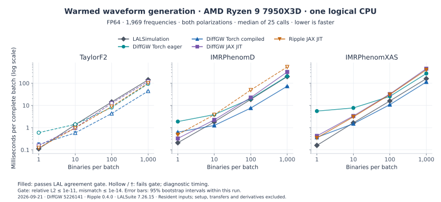
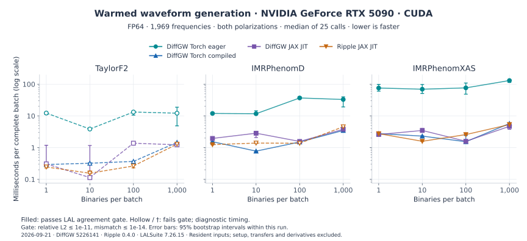
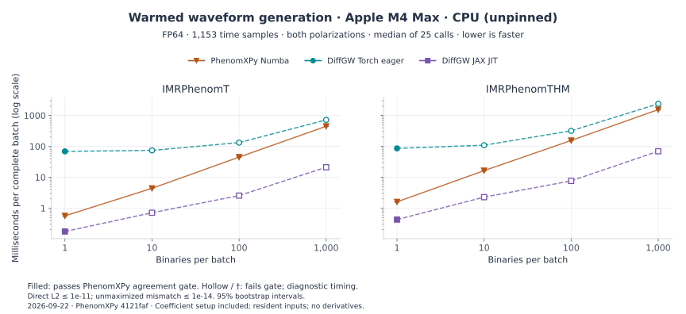

# FP64 waveform benchmarks

Two dated workloads compare forward waveform generation: the frequency-domain
campaign below and the [PhenomXPy time-domain comparison](#phenomxpy-time-domain-comparison-22-september-2026).
Their hardware and grids differ; compare implementations within each campaign.

## Frequency-domain comparison: 21 September 2026

This comparison measures FP64 forward waveform generation in DiffGW, Ripple and
LALSimulation on `mac`, on **21 September 2026**. It covers `TaylorF2`,
`IMRPhenomD` and `IMRPhenomXAS`, each at batches of **1, 10, 100 and 1,000**.
For workload selection and the summary plot, start with [performance](performance.md).
For coverage, see the [package comparison](comparison.md); for scientific discrepancies, see [Differences from LAL](differences_from_lal.md).

### Workload and environment

DiffGW uses an isolated archive of commit
[`5226141887ddd7394c8430537de916d871571358`](https://github.com/xangma/diffgw/commit/5226141887ddd7394c8430537de916d871571358).
Its source hash was checked against that archive before publishing these results.
The benchmark runner is `scripts/compare_packages.py`; its hash and the installed
package versions are recorded in each receipt.

| Setting | Value |
| --- | --- |
| Host | `mac`, Windows 11 with NVIDIA-Workbench WSL2; AMD Ryzen 9 7950X3D |
| CPU execution | Process pinned to logical CPU 0; one thread for PyTorch, OpenMP, MKL and OpenBLAS; XLA CPU multithreaded Eigen disabled |
| GPU | NVIDIA GeForce RTX 5090, 32,607 MiB; driver 610.88 |
| Software | Python 3.12.13; PyTorch 2.14.0; JAX/JAXlib 0.11.1; RippleGW 0.4.0; LALSuite 7.26.15; NumPy 2.5.3 |
| Precision | FP64 inputs, verified `complex128` output |
| Frequency grid | 20–512 Hz inclusive, 0.25 Hz spacing, 1,969 bins |
| Fixed parameters | Distance 400 Mpc, inclination 0.7 rad, reference phase 0, reference frequency 20 Hz |
| TaylorF2 population | Nonspinning; component masses in [1.4, 1.7) and [1.1, 1.3) solar masses; zero tides through adapter defaults (explicit zero inputs for Ripple) |
| PhenomD/XAS population | Component masses in [30, 40) and [20, 25) solar masses; aligned spins independently in [−0.2, 0.2) |
| Sampling | Seed 20260921; distinct binaries; smaller batches are prefixes of larger batches |
| Timing | 3 untimed warmups, 25 timed calls; median and 95% percentile-bootstrap interval using 2,000 seeded resamples |

CPU and GPU campaigns run sequentially. The GPU benchmark's host process is
also pinned to logical CPU 0, so dispatch uses one host core.
This is a workstation measurement, without exclusive host/GPU reservation or
locked clock frequencies. Bootstrap intervals describe variation within this
run, not uncertainty across machines or independent campaigns.

### Timing boundary

Each timed call generates both polarizations for the complete batch from inputs
already resident on the selected device, and waits for completion. Setup,
host/device transfers and output conversion to NumPy are excluded. The compiled
DiffGW and Ripple adapters fix extrinsic parameters; masses and spins remain runtime inputs.
DiffGW's Torch path uses inference mode; the JAX paths use `jax.jit`. The
`torch.compile` adapter checks that at least one graph was captured; its measured
call can still include Python work around compiled graphs.

LAL uses its public uniform-grid API, including zero-frequency padding, followed
by slicing and stacking the requested bins. Its batch timing includes a Python
loop over binaries. Ripple receives chirp mass and symmetric mass ratio, with
conversion from component masses performed during setup; DiffGW receives
component masses. These are timings of the stated public-API adapters, including
their different parameterizations and batching paths.

Receipts also record the first evaluation of each configuration, including
compilation or cache loading as applicable. Imports, adapter setup and parameter
conversion occur before that timer. Compiler caches were not cleared between
smoke checks and the campaign, so this is **not cold-start or isolated compilation
time**. No derivative, time-domain, Fisher, peak-memory or FP32 workload was timed.

### Numerical qualification

Before warming and timing, every binary and both polarizations are compared with
LALSimulation on the same physical grid. Qualification requires direct relative
$L_2 \le 10^{-11}$ and flat-weight mismatch $\le 10^{-14}$. Only the mismatch
maximizes constant phase; neither metric maximizes time, and the direct error
uses no alignment. Nonfinite, zero-norm, wrong-shape or non-`complex128` results
are rejected.

`--record-unqualified` retains timings that fail these thresholds as diagnostic
observations. It does not relax the gate. LAL is the reference, so its comparison
with itself is a consistency check. Passing this gate establishes agreement for
these inputs, not a model's physical accuracy throughout its calibration domain.
Failure of this stringent implementation-agreement gate does not alone determine
suitability for an astrophysical analysis; that depends on the analysis's PSD,
signal-to-noise ratio and accuracy requirements.

#### Accuracy across the measured configurations

The maxima below include both devices, all four batch sizes and both polarizations.
Each implementation/model has eight configurations; counts refer to batches,
not individual binaries. Thresholds are the same for every package.

??? abstract "Detailed accuracy table"

    | Model | Implementation | Qualified configurations | Maximum relative L2 | Maximum mismatch |
    | --- | --- | ---: | ---: | ---: |
    | TaylorF2 | DiffGW Torch eager | 0/8 | 3.437e-11 | 5.551e-16 |
    | TaylorF2 | DiffGW Torch compiled | 0/8 | 3.438e-11 | 5.551e-16 |
    | TaylorF2 | DiffGW JAX JIT | 0/8 | 3.424e-11 | 5.551e-16 |
    | TaylorF2 | Ripple JAX JIT | 0/8 | 3.066e-11 | 5.551e-16 |
    | IMRPhenomD | DiffGW Torch eager | 8/8 | 9.169e-13 | 6.661e-16 |
    | IMRPhenomD | DiffGW Torch compiled | 8/8 | 9.211e-13 | 5.551e-16 |
    | IMRPhenomD | DiffGW JAX JIT | 8/8 | 9.083e-13 | 6.661e-16 |
    | IMRPhenomD | Ripple JAX JIT | 2/8 | 2.806e-11 | 6.661e-16 |
    | IMRPhenomXAS | DiffGW Torch eager | 8/8 | 1.674e-13 | 5.551e-16 |
    | IMRPhenomXAS | DiffGW Torch compiled | 8/8 | 1.521e-13 | 5.551e-16 |
    | IMRPhenomXAS | DiffGW JAX JIT | 8/8 | 1.658e-13 | 4.441e-16 |
    | IMRPhenomXAS | Ripple JAX JIT | 8/8 | 1.680e-13 | 6.661e-16 |

### Warmed batch latency

Values are **milliseconds per complete batch**, shown as median [95% bootstrap
interval]; lower is faster. **† means unqualified** under the numerical gate
above and denotes a diagnostic timing. Throughput is `1,000 × batch / milliseconds`;
amortized time is batch latency divided by batch size. For batches larger than
one, amortized time is not single-waveform request latency.

The plots show every measured configuration, with logarithmic axes and a shared
latency scale across models within each figure. Filled markers pass the agreement
gate; hollow markers fail it. Dashed segments connect points where either endpoint
fails. Error bars show the recorded 95% intervals, which can be smaller than the
markers. Select a plot to view it at full size, or expand its table for exact values.

#### One CPU core

[](benchmarks/plots/package-latency-cpu.svg)

??? abstract "Complete CPU timing table"

    | Model | Implementation | B = 1 | B = 10 | B = 100 | B = 1,000 |
    | --- | --- | ---: | ---: | ---: | ---: |
    | TaylorF2 | LALSimulation | 0.111 [0.11, 0.117] | 1.35 [1.31, 1.37] | 14.3 [13.7, 14.6] | 142 [142, 144] |
    | TaylorF2 | DiffGW Torch eager | 0.593 [0.554, 0.633]† | 1.4 [1.31, 1.43]† | 8.08 [7.81, 8.56]† | 94.4 [88.7, 102]† |
    | TaylorF2 | DiffGW Torch compiled | 0.172 [0.152, 0.208]† | 0.579 [0.538, 0.648]† | 4.31 [4.23, 4.46]† | 44.2 [43, 45.2]† |
    | TaylorF2 | DiffGW JAX JIT | 0.157 [0.134, 0.164]† | 0.96 [0.93, 1.04]† | 12.6 [12, 14.7]† | 120 [118, 122]† |
    | TaylorF2 | Ripple JAX JIT | 0.124 [0.105, 0.137]† | 0.963 [0.922, 1.02]† | 8.85 [8.51, 9.18]† | 101 [99.6, 102]† |
    | IMRPhenomD | LALSimulation | 0.209 [0.192, 0.223] | 1.81 [1.77, 1.9] | 18.7 [18.1, 19.6] | 199 [196, 200] |
    | IMRPhenomD | DiffGW Torch eager | 1.88 [1.76, 1.95] | 3.85 [3.73, 3.91] | 20 [19.3, 20.6] | 207 [205, 209] |
    | IMRPhenomD | DiffGW Torch compiled | 0.626 [0.573, 0.643] | 1.25 [1.17, 1.33] | 7.6 [7.06, 7.81] | 73.1 [71.9, 74.5] |
    | IMRPhenomD | DiffGW JAX JIT | 0.326 [0.304, 0.341] | 2.23 [2.18, 2.29] | 22.6 [22.1, 22.9] | 321 [314, 329] |
    | IMRPhenomD | Ripple JAX JIT | 0.485 [0.469, 0.501] | 3.8 [3.78, 3.94]† | 49.3 [48.6, 49.5]† | 539 [525, 550]† |
    | IMRPhenomXAS | LALSimulation | 0.159 [0.154, 0.18] | 1.65 [1.63, 1.72] | 15.8 [15.4, 16.3] | 160 [157, 166] |
    | IMRPhenomXAS | DiffGW Torch eager | 5.55 [5.44, 5.68] | 7.71 [7.58, 7.96] | 25.4 [25, 25.6] | 272 [265, 315] |
    | IMRPhenomXAS | DiffGW Torch compiled | 0.366 [0.341, 0.398] | 1.5 [1.4, 1.54] | 10.8 [10.5, 11] | 114 [113, 114] |
    | IMRPhenomXAS | DiffGW JAX JIT | 0.424 [0.407, 0.456] | 3.33 [3.17, 3.41] | 32.4 [31.7, 32.8] | 450 [443, 453] |
    | IMRPhenomXAS | Ripple JAX JIT | 0.345 [0.332, 0.355] | 3.05 [3, 3.14] | 30.9 [30.4, 31.7] | 400 [396, 406] |

#### RTX 5090 GPU

[](benchmarks/plots/package-latency-gpu.svg)

??? abstract "Complete GPU timing table"

    | Model | Implementation | B = 1 | B = 10 | B = 100 | B = 1,000 |
    | --- | --- | ---: | ---: | ---: | ---: |
    | TaylorF2 | DiffGW Torch eager | 12.3 [11, 13.2]† | 3.86 [3.71, 3.96]† | 13.2 [10.6, 13.4]† | 12.2 [4.86, 18.8]† |
    | TaylorF2 | DiffGW Torch compiled | 0.293 [0.277, 0.333]† | 0.322 [0.296, 0.335]† | 0.368 [0.365, 0.371]† | 1.46 [1.43, 1.47]† |
    | TaylorF2 | DiffGW JAX JIT | 0.308 [0.286, 1.18]† | 0.114 [0.108, 1.17]† | 1.38 [1.36, 1.42]† | 1.23 [1.21, 1.24]† |
    | TaylorF2 | Ripple JAX JIT | 0.246 [0.229, 0.277]† | 0.156 [0.149, 0.184]† | 0.264 [0.23, 0.277]† | 1.29 [1.26, 1.31]† |
    | IMRPhenomD | DiffGW Torch eager | 12 [11.8, 12.6] | 11.7 [11.2, 14.5] | 36.8 [35.1, 40.8] | 32.9 [19.2, 40] |
    | IMRPhenomD | DiffGW Torch compiled | 1.54 [1.48, 1.58] | 0.776 [0.742, 0.796] | 1.51 [1.41, 1.58] | 3.48 [3.39, 3.59] |
    | IMRPhenomD | DiffGW JAX JIT | 1.95 [1.88, 1.97] | 2.85 [2.09, 2.95] | 1.57 [1.55, 1.6] | 3.78 [3.73, 3.81] |
    | IMRPhenomD | Ripple JAX JIT | 1.24 [1.23, 1.27] | 1.39 [1.34, 1.43]† | 1.37 [1.35, 1.39]† | 4.54 [4.51, 4.57]† |
    | IMRPhenomXAS | DiffGW Torch eager | 75.7 [60.2, 98.6] | 69.4 [51.1, 97.7] | 76.6 [48.5, 109] | 130 [113, 139] |
    | IMRPhenomXAS | DiffGW Torch compiled | 2.76 [2.61, 2.86] | 2.31 [2.17, 2.37] | 1.54 [1.48, 2.4] | 5.75 [5.58, 5.76] |
    | IMRPhenomXAS | DiffGW JAX JIT | 2.59 [2.57, 2.62] | 3.48 [3.22, 4] | 1.58 [1.54, 1.63] | 4.7 [3.79, 4.74] |
    | IMRPhenomXAS | Ripple JAX JIT | 2.75 [2.5, 2.77] | 1.58 [1.56, 1.63] | 2.58 [2.56, 2.72] | 5.34 [5.23, 5.37] |

LALSimulation was measured on the CPU only. Compare GPU implementations in the
GPU plot and table; a ratio to the CPU baseline combines hardware
and implementation differences.

### Reproduction and receipts

The receipts contain actual parameters, errors per binary/polarization, all raw
timings, first-call costs, bootstrap intervals, software/hardware provenance and
content/source/runner SHA-256 hashes:

- [CPU receipt](benchmarks/mac-20260921-cpu.json)
- [GPU receipt](benchmarks/mac-20260921-gpu.json)

Use the declared DiffGW source revision and the runner matching the receipt's
hash. The `--source-commit` argument is a provenance label; independently check
the source contents, especially when running from a working tree.

```bash
export OMP_NUM_THREADS=1 MKL_NUM_THREADS=1 OPENBLAS_NUM_THREADS=1
export JAX_ENABLE_X64=1 XLA_PYTHON_CLIENT_PREALLOCATE=false
export XLA_FLAGS=--xla_cpu_multi_thread_eigen=false

taskset -c 0 python scripts/compare_packages.py \
    --models TaylorF2 IMRPhenomD IMRPhenomXAS \
    --backends lal torch torch_compiled jax ripple \
    --device cpu --batches 1 10 100 1000 \
    --source-commit 5226141887ddd7394c8430537de916d871571358 \
    --record-unqualified --output cpu.json

taskset -c 0 python scripts/compare_packages.py \
    --models TaylorF2 IMRPhenomD IMRPhenomXAS \
    --backends torch torch_compiled jax ripple \
    --device cuda --batches 1 10 100 1000 \
    --source-commit 5226141887ddd7394c8430537de916d871571358 \
    --record-unqualified --output gpu.json
```

`taskset` is Linux-specific; use an available core and record affinity on other
hosts. LAL remains the CPU accuracy reference during the GPU campaign. See the
[benchmark protocol](benchmarking_protocol.md) for the broader qualification
requirements and the [performance summary](performance.md) for interpretation
and the scope of these measurements.

#### Regenerating the plots

With Matplotlib installed, regenerate the maintained SVG figures from the two
committed receipts without rerunning the benchmarks:

```bash
python scripts/plot_package_benchmarks.py
```

The generator verifies receipt hashes, configuration completeness and matching
CPU/GPU workloads before plotting. It uses the recorded medians, bootstrap
intervals and qualification flags. All 108 timed configurations appear in the
scaling plots; the performance overview selects PhenomD/XAS at batch 1,000
and includes every measured implementation for those cases.

Use `--format pdf --output-dir /tmp/diffgw-plots` for a PDF export, or
`--format png` for raster images.

## PhenomXPy time-domain comparison: 22 September 2026

This CPU workload compares **IMRPhenomT and IMRPhenomTHM** in DiffGW and
[PhenomXPy](https://gitlab.com/imrphenom-dev/phenomxpy). It measures both real
polarizations on a fixed time grid, at batches of **1, 10, 100 and 1,000**.
It does not measure TP/TPHM, GPU execution, compiled PyTorch, derivatives or
Fourier transforms. Its Apple CPU timings should not be divided by the Ryzen
or RTX timings above to infer a package speedup.

### Time-domain workload and timing

| Setting | Value |
| --- | --- |
| Date and hardware | 22 September 2026; Apple M4 Max; macOS 26.6; CPU only |
| Thread settings | PyTorch intra-op and Numba: 1; OpenMP/MKL/OpenBLAS environment limits: 1; XLA CPU multithreaded Eigen disabled. Process not pinned; no exclusive reservation or locked clocks. These settings do not establish a single-core JAX execution limit. |
| Software | Python 3.13.7; PyTorch 2.14.0; JAX/JAXlib 0.11.2; Numba 0.67.0; NumPy 2.5.3; SciPy 1.18.1 |
| PhenomXPy | Git revision `4121fafa0484f3db2a7352f4eea697faaaf29f65` (`2.0.3.post6+g4121fafa0`); CPU Numba enabled; `PHENOMXPY_CONSTANTS=hardcoded`; no conditioning; modes evaluated separately |
| DiffGW | Working tree based on `5f3e572`; individual source hashes, combined source hash, runner hash and dirty-tree flag recorded in the receipt |
| Time grid | −0.5 to +0.0625 seconds relative to the peak, inclusive; 1/2,048-second spacing; 1,153 samples; no taper or start mask in DiffGW's fixed-grid method |
| Models and modes | T: (2, ±2); THM: (2, ±2), (2, ±1), (3, ±3), (4, ±4), (5, ±5). PhenomXPy THM selection is explicit and matches the verified DiffGW defaults. |
| Binary population | Same seeded mass/spin population as PhenomD/XAS above: 30–40 and 20–25 solar masses, aligned spins −0.2 to 0.2, seed 20260921; smaller batches are prefixes |
| Extrinsic parameters | 400 Mpc; inclination 0.7 rad; orbital reference phase 0; reference frequency 20 Hz; PhenomXPy `f_min=20`, polarization angle 0 |
| Sampling | 3 warmups; 25 completed calls per configuration; median and 95% percentile-bootstrap interval from 2,000 seeded resamples |

The timer includes **parameter-dependent coefficient construction and waveform
evaluation** in both packages. PhenomXPy constructs a fresh model for every
binary, calls `compute_polarizations(times)`, then stacks the polarizations in a
Python loop. DiffGW creates its parameter-free model object outside timing;
`time_domain` constructs coefficients inside each call and evaluates a tensor
batch. PyTorch uses inference mode; JAX uses `jax.jit`, with masses and spins
passed as runtime inputs. Setup of resident inputs and reference
parameterization, imports, transfers and host conversion are excluded. Each
JAX call is synchronized before the clock stops.

The pinned PhenomXPy runtime returns `(hp, hc, times)` for these models. The
adapter checks both polarizations and the returned physical grid (absolute
round-trip tolerance of two FP64 epsilons in seconds). It does not interpolate
or align the outputs. The time interval is a fixed waveform segment, not a
claim to include every sample from 20 Hz for every binary.

First-call observations are retained in the receipt. The oracle has already
executed before these observations, so PhenomXPy's Numba compilation/cache
loading is already warm; DiffGW JAX may still compile its new batch shape.
Caches were not cleared. These observations are not comparable cold-start or
isolated compilation measurements.

### Time-domain numerical qualification

Every binary and each polarization are checked against the pinned PhenomXPy
output. The declared gate is direct relative L2 ≤ `1e-11` and flat-weight
real-series mismatch ≤ `1e-14`, with **no phase, sign, polarization or time
maximization**. Wrong shapes, non-FP64 outputs, nonfinite values and zero norms
are rejected. PhenomXPy's check against itself is a consistency check.

DiffGW's T-family includes adapted author fits from this PhenomXPy revision,
so agreement here is an implementation check, not independent physical
validation. Results above the threshold remain **unqualified diagnostic
timings**, marked † and shown with hollow markers. The gate is not relaxed to
make a performance claim.

| Model | Implementation | Qualified batches | Maximum relative L2 | Maximum mismatch |
| --- | --- | ---: | ---: | ---: |
| IMRPhenomT | PhenomXPy Numba | 4/4 | 0.000e+00 | 2.220e-16 |
| IMRPhenomT | DiffGW Torch eager | 1/4 | 3.072e-11 | 3.331e-16 |
| IMRPhenomT | DiffGW JAX JIT | 1/4 | 3.064e-11 | 3.331e-16 |
| IMRPhenomTHM | PhenomXPy Numba | 4/4 | 0.000e+00 | 2.220e-16 |
| IMRPhenomTHM | DiffGW Torch eager | 1/4 | 3.082e-11 | 3.331e-16 |
| IMRPhenomTHM | DiffGW JAX JIT | 1/4 | 3.071e-11 | 4.441e-16 |

### Time-domain batch latency

For the single-binary cases, which pass the gate, JAX JIT takes about
0.176 ms for T and 0.427 ms for THM, versus PhenomXPy's 0.564 ms and 1.60 ms.
Eager PyTorch takes 68.7 ms and 86.0 ms. Larger DiffGW batches have maximum
relative errors up to `3.08e-11`, so their timings below remain diagnostic
under the declared `1e-11` gate. These results do not predict compiled PyTorch
or GPU performance.

Milliseconds per complete batch, median [95% bootstrap interval]; lower is
faster. **† denotes a failed numerical gate**, even when the discrepancy is
small. Intervals describe variation within this workstation run, not across
machines or independent campaigns.

[](benchmarks/plots/package-latency-phenomxpy-cpu.svg)

??? abstract "Complete time-domain timing table"

    | Model | Implementation | B = 1 | B = 10 | B = 100 | B = 1,000 |
    | --- | --- | ---: | ---: | ---: | ---: |
    | IMRPhenomT | PhenomXPy Numba | 0.564 [0.545, 0.63] | 4.38 [4.31, 4.55] | 44.9 [44.5, 45.3] | 447 [444, 458] |
    | IMRPhenomT | DiffGW Torch eager | 68.7 [67.7, 69.3] | 74 [73.6, 74.5]† | 132 [132, 133]† | 717 [716, 720]† |
    | IMRPhenomT | DiffGW JAX JIT | 0.176 [0.166, 0.181] | 0.711 [0.697, 0.73]† | 2.55 [2.51, 2.82]† | 21.1 [20.7, 21.4]† |
    | IMRPhenomTHM | PhenomXPy Numba | 1.6 [1.55, 1.66] | 16.4 [16.2, 16.5] | 155 [153, 156] | 1.54e+03 [1.52e+03, 1.56e+03] |
    | IMRPhenomTHM | DiffGW Torch eager | 86 [85.7, 86.8] | 109 [108, 109]† | 317 [316, 318]† | 2.38e+03 [2.38e+03, 2.39e+03]† |
    | IMRPhenomTHM | DiffGW JAX JIT | 0.427 [0.407, 0.45] | 2.27 [2.22, 2.32]† | 7.62 [7.05, 8.49]† | 69.4 [67.8, 70.4]† |

### Reproduce the PhenomXPy comparison

The [time-domain receipt](benchmarks/m4max-20260922-phenomxpy-cpu.json) records
parameters, errors for each binary/polarization, raw timings, first calls,
software versions, source-file hashes and a content checksum. Use the DiffGW
source and runner matching those hashes. The runner requires the exact Git
installation below; the PyPI wheel alone does not supply the required commit
provenance. Keep the reference package in a benchmark environment rather than
adding it as a DiffGW runtime dependency.

```bash
python -m venv /tmp/diffgw-phenomxpy-bench
source /tmp/diffgw-phenomxpy-bench/bin/activate
python -m pip install numpy==2.5.3 scipy==1.18.1 torch==2.14.0 \
  jax==0.11.2 jaxlib==0.11.2 numba==0.67.0 \
  'git+https://gitlab.com/imrphenom-dev/phenomxpy.git@4121fafa0484f3db2a7352f4eea697faaaf29f65'

export NUMBA_NUM_THREADS=1 OMP_NUM_THREADS=1 MKL_NUM_THREADS=1 OPENBLAS_NUM_THREADS=1
export JAX_ENABLE_X64=1 XLA_FLAGS=--xla_cpu_multi_thread_eigen=false
python scripts/compare_phenomxpy.py --record-unqualified \
  --output /tmp/phenomxpy-cpu.json

# With matplotlib installed, render the saved receipt without rerunning timings:
python scripts/plot_package_benchmarks.py --phenomxpy /tmp/phenomxpy-cpu.json \
  --output-dir /tmp/phenomxpy-plots
```

The [official API documentation](https://phenomxpy.readthedocs.io/en/latest/approximants.html)
and [pinned README](https://gitlab.com/imrphenom-dev/phenomxpy/-/blob/4121fafa0484f3db2a7352f4eea697faaaf29f65/README.md)
describe the public interfaces and CPU/GPU options. This measurement covers only
the adapters and CPU settings recorded here.
