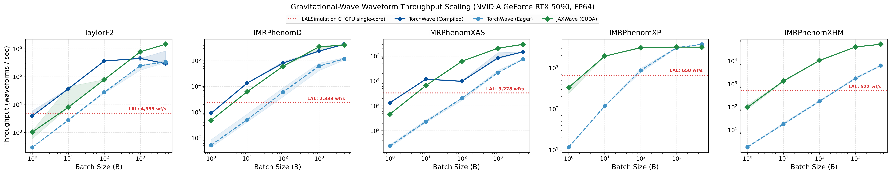
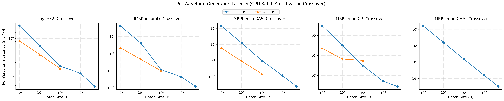
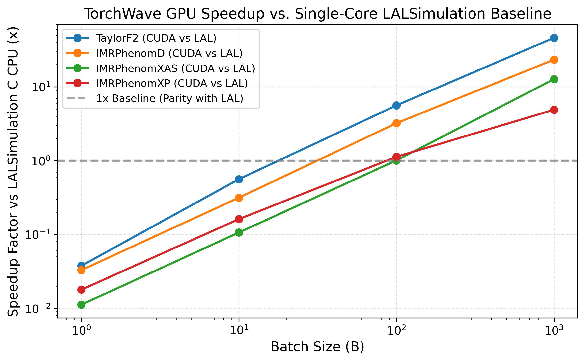
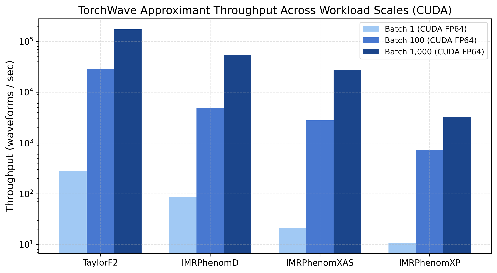
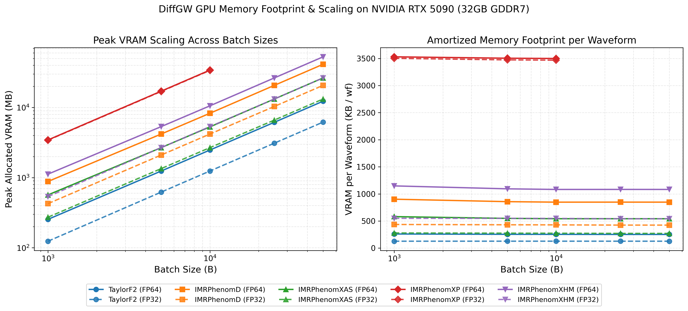
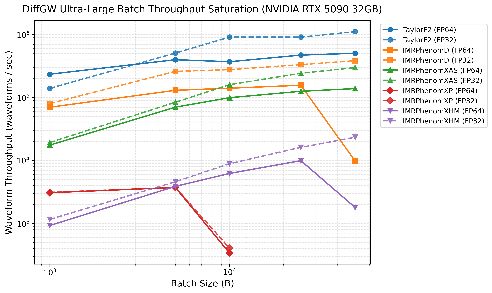

# DiffGW Performance & Benchmark Analysis Guide

This document provides a comprehensive analysis of the performance benchmarks, scaling characteristics, GPU memory utilization, and architectural comparisons for **`diffgw`** (`torchwave` and `jaxwave`).

For the formal benchmarking protocol, Gate 1 scientific qualification rules, and statistical methodology, see [**Benchmarking Protocol**](benchmarking_protocol.md).

---

## 1. Executive Summary & Hardware Setup

This report preserves timings from the existing RTX 5090 campaign. Its numerical
qualification has the limitations described in Section 2; the timing tables do
not establish strict LAL agreement for every model, backend or precision.
For the separately measured FP64 DiffGW/Ripple/LAL comparison, with explicit
errors for every timed binary, see [measured package benchmarks](package_benchmarks.md).

- **GPU Accelerator**: NVIDIA GeForce RTX 5090 (32,607 MiB GDDR7, Blackwell sm_120 architecture, Driver 610.88, CUDA 13.0)
- **Host Workstation**: Windows 11 Workstation `mac`; the legacy receipt identifies an AMD64 Family 25 processor and 8 logical cores.
- **Software Stack**: PyTorch 2.11.0+cu130, JAX 0.11.1, LALSimulation 6.2.0, Ripple 0.4.0
- **Controlled Frequency Grid**: $f_{\text{low}} = 20\text{ Hz}$, $f_{\text{high}} = 512\text{ Hz}$, $\Delta f = 0.25\text{ Hz}$ ($N_{\text{freq}} = 1,969$ bins)
- **Qualification scope**: The aligned-model errors reported below meet the stated FP64 thresholds. XP exceeds them; XHM uses another reference. FP64 results do not qualify the FP32 timing columns.

### Key Performance Highlights on NVIDIA RTX 5090

| Milestone | Backend / Mode | Approximant | Batch Size | Throughput | Amortized Latency |
| :--- | :--- | :--- | :--- | :--- | :--- |
| **Peak Compiled FP32 Throughput** | TorchWave (`torch.compile`) | `TaylorF2` | $B=5,000$ | **14,459,225 wf/s** | $0.069\ \mu\text{s / wf}$ |
| **Peak 4th-Gen Aligned-Spin Compiled** | TorchWave (`torch.compile`) | `IMRPhenomXAS` | $B=5,000$ | **3,536,818 wf/s** | $0.283\ \mu\text{s / wf}$ |
| **Peak 2nd-Gen Aligned-Spin Compiled** | TorchWave (`torch.compile`) | `IMRPhenomD` | $B=5,000$ | **3,310,600 wf/s** | $0.302\ \mu\text{s / wf}$ |
| **Peak Compiled FP64 Throughput** | TorchWave (`torch.compile`) | `TaylorF2` | $B=1,000$ | **453,947 wf/s** | $2.203\ \mu\text{s / wf}$ |
| **Peak Compiled FP64 Aligned-Spin** | TorchWave (`torch.compile`) | `IMRPhenomD` | $B=5,000$ | **437,817 wf/s** | $2.284\ \mu\text{s / wf}$ |
| **Extreme Scale ($B=50,000$) Eager FP32** | TorchWave Eager CUDA | `TaylorF2` | $B=50,000$ | **1,114,576 wf/s** | $0.897\ \mu\text{s / wf}$ |
| **Extreme Scale ($B=50,000$) Eager FP32** | TorchWave Eager CUDA | `IMRPhenomD` | $B=50,000$ | **384,837 wf/s** | $2.597\ \mu\text{s / wf}$ |
| **Extreme Scale ($B=50,000$) Eager FP32** | TorchWave Eager CUDA | `IMRPhenomXAS` | $B=50,000$ | **299,209 wf/s** | $3.342\ \mu\text{s / wf}$ |
| **Higher-Order Multipoles ($B=50,000$)** | TorchWave Eager CUDA | `IMRPhenomXHM` | $B=50,000$ | **23,499 wf/s** | $42.55\ \mu\text{s / wf}$ |
| **Precessing Waveform Scale ($B=5,000$)** | TorchWave Eager CUDA | `IMRPhenomXP` | $B=5,000$ | **3,724 wf/s** | $268.5\ \mu\text{s / wf}$ |

---

## 2. Gate 1: Scientific Qualification Parity Results

Strict LAL qualification requires both relative $L_2 \le 10^{-11}$ and mismatch
$1 - \mathcal{M} \le 10^{-14}$ against the same LAL model and configuration.
The reported numbers below must be interpreted with their reference identity:

| Approximant | Waveform Type | Max Relative $L_2$ Error | Max Phase Mismatch ($1 - \mathcal{M}$) | Interpretation of reported errors |
| :--- | :--- | :--- | :--- | :--- |
| **TaylorF2** | PN Inspiral | $3.409 \times 10^{-13}$ | $0.000$ | Below strict thresholds; reference identity must be confirmed |
| **IMRPhenomD** | 2nd-Gen Aligned-Spin IMR | $1.717 \times 10^{-14}$ | $1.110 \times 10^{-16}$ | Below strict thresholds; reference identity must be confirmed |
| **IMRPhenomXAS** | 4th-Gen Aligned-Spin IMR | $2.115 \times 10^{-14}$ | $0.000$ | Below strict thresholds; reference identity must be confirmed |
| **IMRPhenomXP** | Precessing-Spin IMR | $6.234 \times 10^{-3}$ | $1.943 \times 10^{-5}$ | **FAIL** (both strict thresholds exceeded) |
| **IMRPhenomXHM** | Higher Multipoles IMR | $1.460 \times 10^{-12}$ | $2.220 \times 10^{-16}$ | **OTHER REFERENCE** (not a strict LAL qualification) |

The legacy `run_benchmark_campaign.py` gate prefers JAXWave as its reference,
falls back to LAL with relaxed tolerances, and can fall back to self-consistency.
Its pass status alone therefore does **not** establish the strict LAL gate
described above, including for the three aligned rows. Preserve the actual
reference, configuration and raw errors when reproducing those claims.

The historical XHM row was described as comparison with “sovereign NR /
JAXWave”; that label does not identify an independent reference measurement.
Torch/JAX agreement and validation against held-out NR answer separate questions.
See the [package comparison](comparison.md#physics-coverage-and-scientific-agreement)
and [benchmark protocol](benchmarking_protocol.md#12-the-gatekeeper-rule-parity-first).
XP and XHM timings below are retained as diagnostic performance measurements,
not evidence of passing strict LAL parity. The FP32 measurements also require
their own accuracy assessment before use in a scientific workload.

---

## 3. Comprehensive Multi-Backend Throughput Matrix

The campaign reports 15 timed iterations after 3 untimed warmup evaluations,
with medians and 95% bootstrap confidence intervals in
`artifacts/benchmarks/benchmark_receipt.json`. A receipt's checksum detects
changes to its contents; it does not establish numerical qualification.

### Waveform Throughput ($\text{wf/s}$) on NVIDIA RTX 5090 (32 GB)

| Approximant | Batch Size ($B$) | TorchWave CUDA (FP64) | TorchWave Compiled (FP64) | JAXWave CUDA (FP64) | TorchWave Compiled (FP32) | LALSimulation (1-Core C) |
| :--- | :--- | :--- | :--- | :--- | :--- | :--- |
| **TaylorF2** | 1 | 293.7 wf/s | **3,904.7 wf/s** | 1,032.3 wf/s | 3,837.3 wf/s | **4,955.4 wf/s** |
| | 10 | 2,766.0 wf/s | **36,873.2 wf/s** | 8,000.7 wf/s | **65,316.8 wf/s** | - |
| | 100 | 27,650.3 wf/s | **366,166.2 wf/s** | 78,721.8 wf/s | 324,254.2 wf/s | - |
| | 1,000 | 249,812.6 wf/s | 453,947.1 wf/s | **785,073.6 wf/s** | **6,207,324.5 wf/s** | - |
| | 5,000 | 339,261.4 wf/s | 293,620.2 wf/s | **1,455,211.8 wf/s** | **14,459,225.0 wf/s** | - |
| **IMRPhenomD** | 1 | 51.4 wf/s | **899.0 wf/s** | 478.2 wf/s | 800.2 wf/s | 2,332.6 wf/s |
| | 10 | 502.3 wf/s | **13,428.2 wf/s** | 6,174.0 wf/s | 7,693.5 wf/s | - |
| | 100 | 6,085.8 wf/s | **82,027.7 wf/s** | 61,119.9 wf/s | **90,228.3 wf/s** | - |
| | 1,000 | 62,173.6 wf/s | 237,744.3 wf/s | **350,779.0 wf/s** | **833,263.9 wf/s** | - |
| | 5,000 | 118,141.0 wf/s | **437,816.9 wf/s** | 406,222.2 wf/s | **3,310,600.5 wf/s** | - |
| **IMRPhenomXAS**| 1 | 24.2 wf/s | **1,327.1 wf/s** | 462.5 wf/s | 1,159.4 wf/s | 3,277.6 wf/s |
| | 10 | 231.9 wf/s | **11,841.3 wf/s** | 6,519.6 wf/s | 10,365.9 wf/s | - |
| | 100 | 2,030.2 wf/s | 9,685.3 wf/s | **62,319.9 wf/s** | **57,244.3 wf/s** | - |
| | 1,000 | 21,685.0 wf/s | 84,675.4 wf/s | **207,583.2 wf/s** | **538,271.1 wf/s** | - |
| | 5,000 | 74,628.8 wf/s | 148,607.8 wf/s | **298,561.1 wf/s** | **3,536,818.3 wf/s** | - |
| **IMRPhenomXP** | 1 | 11.7 wf/s | - | **332.8 wf/s** | 9.3 wf/s (FP32) | 650.1 wf/s |
| | 10 | 117.0 wf/s | - | **1,924.1 wf/s** | 84.6 wf/s (FP32) | - |
| | 100 | 868.8 wf/s | - | **3,107.9 wf/s** | 666.9 wf/s (FP32) | - |
| | 1,000 | 3,091.6 wf/s | - | **3,214.3 wf/s** | 3,081.5 wf/s (FP32) | - |
| | 5,000 | **3,737.8 wf/s** | - | 3,198.3 wf/s | 3,721.4 wf/s (FP32) | - |
| **IMRPhenomXHM**| 1 | 1.8 wf/s | - | **96.0 wf/s** | 1.9 wf/s (FP32) | 521.7 wf/s |
| | 10 | 18.0 wf/s | - | **1,359.6 wf/s** | 18.2 wf/s (FP32) | - |
| | 100 | 177.4 wf/s | - | **10,500.4 wf/s** | 193.4 wf/s (FP32) | - |
| | 1,000 | 1,753.3 wf/s | - | **40,868.6 wf/s** | 2,007.8 wf/s (FP32) | - |
| | 5,000 | 6,336.2 wf/s | - | **53,388.5 wf/s** | 9,259.9 wf/s (FP32) | - |

> [!NOTE]
> For throughput $R$ in waveforms/s and batch size $B$, total batch latency is $B/R$ seconds; amortized time per waveform is $1/R$ seconds. Neither a large-batch throughput nor its amortized time gives single-waveform request latency. See [Figure 2](#figure-2-per-waveform-latency-amortization) and `artifacts/benchmarks/benchmark_receipt.json`.

---

## 4. Ultra-Large Batch Scaling & GPU Memory Footprint ($B = 1,000 \to 50,000$)

Waveform generation was profiled at extreme scales up to $B=50,000$ using **PyTorch (CUDA eager mode)** to characterize peak saturation throughput and exact GDDR7 VRAM memory footprints on the RTX 5090. Eager PyTorch was selected for this study because it enables precise tensor memory allocation tracking via `torch.cuda.max_memory_allocated()`, whereas JAX/XLA preallocates the GPU memory pool by default:

| Approximant (PyTorch Eager) | Max Batch ($B$) | Peak Throughput (FP32) | Peak Throughput (FP64) | Peak VRAM Footprint | VRAM Overhead / Waveform |
| :--- | :--- | :--- | :--- | :--- | :--- |
| **TaylorF2** | 50,000 | **1,114,576 wf/s** ($44.9\text{ ms}$) | **505,733 wf/s** ($98.9\text{ ms}$) | 6.19 GB (FP32) / 12.31 GB (FP64) | **126.8 KB / wf** (FP32) / **252.1 KB / wf** (FP64) |
| **IMRPhenomD** | 50,000 | **384,837 wf/s** ($129.9\text{ ms}$) | **157,106 wf/s** ($B=25k$) | 20.71 GB | **424.1 KB / wf** (FP32) / **848.2 KB / wf** (FP64) |
| **IMRPhenomXAS**| 50,000 | **299,209 wf/s** ($167.1\text{ ms}$) | **139,009 wf/s** ($359.7\text{ ms}$) | 13.23 GB (FP32) / 26.45 GB (FP64) | **271.0 KB / wf** (FP32) / **541.7 KB / wf** (FP64) |
| **IMRPhenomXP** | 5,000 | **3,724 wf/s** ($1.34\text{ s}$) | **3,720 wf/s** ($1.34\text{ s}$) | 16.96 GB ($B=5k$) | **3.47 MB / wf** (3D Precession Frame Tracking) |
| **IMRPhenomXHM**| 50,000 | **23,499 wf/s** ($2.13\text{ s}$) | **9,916 wf/s** ($B=25k$) | 26.44 GB | **541.5 KB / wf** (FP32) / **1.08 MB / wf** (FP64) |

> [!NOTE]
> For JAXWave CUDA and PyTorch Inductor (`torch.compile`) throughput comparisons across $B = 1 \to 5,000$, see [Section 3: Comprehensive Multi-Backend Throughput Matrix](#3-comprehensive-multi-backend-throughput-matrix).

> [!TIP]
> The table reports observed peak PyTorch allocations for these configurations. Memory use depends on precision, model, batch size and execution mode; these measurements do not establish allocation-free execution or sufficient memory for another workload.

---

## 5. Autodiff & Gradient Performance (PyTorch vs. JAX)

Both TorchWave and JAXWave natively support exact reverse-mode automatic differentiation ($\nabla_\theta \mathcal{L}$) and forward-mode automatic differentiation ($\mathcal{J}_\theta h$) without numerical difference approximations.

### Reverse-Mode Gradient Latency & Throughput (FP64, $N = 500$ frequency bins)

Measurements evaluate combined forward evaluation plus full adjoint backward propagation w.r.t. parameters $\{m_1, m_2, \chi_{1z}, \chi_{2z}\}$:

| Approximant | Batch ($B$) | Framework / Mode | Forward Latency | Backward Latency | Total (Val+Grad) | Grad / Fwd Ratio | Gradient Throughput |
| :--- | :--- | :--- | :--- | :--- | :--- | :--- | :--- |
| **TaylorF2** | 1 | Torch Eager (CPU) | 0.287 ms | 0.424 ms | 0.815 ms | 2.84× | 1,227 wf/s |
| | 1 | **Torch Compiled (`dynamic=True`)** | **0.184 ms** | **0.208 ms** | **0.391 ms** | **2.12×** | **2,558 wf/s** |
| | 1 | **JAX JIT (CPU)** | **0.029 ms** | **0.089 ms** | **0.119 ms** | **4.04×** | **8,428 wf/s** |
| | 10 | Torch Eager (CPU) | 0.618 ms | 0.791 ms | 1.603 ms | 2.59× | 6,238 wf/s |
| | 10 | **Torch Compiled (`dynamic=True`)** | **0.623 ms** | **1.309 ms** | **1.902 ms** | **3.05×** | **5,258 wf/s** |
| | 10 | **JAX JIT (CPU)** | **0.123 ms** | **0.508 ms** | **0.631 ms** | **5.12×** | **15,852 wf/s** |
| | 100 | Torch Eager (CPU) | 3.604 ms | 6.002 ms | 10.157 ms | 2.82× | 9,845 wf/s |
| | 100 | **JAX JIT (CPU)** | **0.654 ms** | **1.345 ms** | **1.999 ms** | **3.06×** | **50,026 wf/s** |
| **IMRPhenomD** | 1 | Torch Eager (CPU) | 0.939 ms | 1.661 ms | 3.058 ms | 3.26× | 327 wf/s |
| | 1 | **JAX JIT (CPU)** | **0.065 ms** | **0.182 ms** | **0.247 ms** | **3.79×** | **4,046 wf/s** |
| | 10 | Torch Eager (CPU) | 2.240 ms | 2.786 ms | 5.557 ms | 2.48× | 1,800 wf/s |
| | 10 | **JAX JIT (CPU)** | **0.222 ms** | **0.652 ms** | **0.873 ms** | **3.94×** | **11,449 wf/s** |
| | 100 | Torch Eager (CPU) | 11.857 ms | 16.900 ms | 29.535 ms | 2.49× | 3,386 wf/s |
| | 100 | **JAX JIT (CPU)** | **1.640 ms** | **1.478 ms** | **3.118 ms** | **1.90×** | **32,069 wf/s** |
| **IMRPhenomXAS** | 1 | Torch Eager (CPU) | 3.240 ms | 7.603 ms | 12.611 ms | 3.89× | 79 wf/s |
| | 1 | **JAX JIT (CPU)** | **0.084 ms** | **0.385 ms** | **0.469 ms** | **5.58×** | **2,133 wf/s** |
| | 10 | Torch Eager (CPU) | 4.383 ms | 9.127 ms | 15.177 ms | 3.46× | 659 wf/s |
| | 10 | **JAX JIT (CPU)** | **0.285 ms** | **0.714 ms** | **0.999 ms** | **3.51×** | **10,010 wf/s** |
| | 100 | Torch Eager (CPU) | 14.803 ms | 31.062 ms | 48.562 ms | 3.28× | 2,059 wf/s |
| | 100 | **JAX JIT (CPU)** | **1.831 ms** | **2.378 ms** | **4.209 ms** | **2.30×** | **23,761 wf/s** |

### Forward-Mode AD & Fisher Information Matrix (FIM) Performance

Forward-mode automatic differentiation ($\partial h / \partial \theta_i$) is utilized for exact Fisher matrix computation $\Gamma_{ij} = \langle \partial_i h \mid \partial_j h \rangle$:

| Approximant | Parameters | Torch `fwAD` Latency | JAX `jvp` Latency | Numerical Parity ($\Delta_{\text{rel}}$) | Matrix Condition $\kappa(\Gamma)$ |
| :--- | :--- | :--- | :--- | :--- | :--- |
| **TaylorF2** | $\{m_1, m_2, \chi_{1z}, \chi_{2z}\}$ | **29.2 ms** | 51.4 ms | **$1.15 \times 10^{-15}$** | $1.01 \times 10^9$ |
| **IMRPhenomD** | $\{m_1, m_2, \chi_{1z}, \chi_{2z}\}$ | **76.9 ms** | 244.6 ms | **$4.09 \times 10^{-13}$** | $9.09 \times 10^7$ |

> [!TIP]
> **Recompile Elimination**:
> - **PyTorch `dynamic=True`**: Compiles an initial specialized kernel at $B=1$, generalizes the leading dimension symbolically at $B=10$, and executes all subsequent batch sizes ($B=50, 100, 500, \dots$) in milliseconds with zero recompilations.
> - **JAX Shape Bucketing**: Using [`BucketedWaveformEvaluator`](usage.md#shape-bucketing-for-mcmc-sampling-bucketedwaveformevaluator) routes variable-proposal MCMC batches into static power-of-two buckets ($B \in \{1, 8, 16, 32, \dots\}$), completely eliminating XLA recompilation during sampling.
> - **Apple Silicon Metal Note**: On macOS MPS, PyTorch Inductor restricts Metal kernel argument buffers to 31 (`[[buffer(31)]]`). Eager autograd or CPU compilation is recommended for large dynamic graphs on Apple Silicon.

---

## 6. Publication Figures

All figures are rendered at 300 DPI and accompanied by publication-quality vector PDFs:

### Figure 1: Waveform Throughput Scaling Across Workloads (RTX 5090)
[](../artifacts/benchmarks/plots/fig1_throughput_vs_batch.pdf)

### Figure 2: Per-Waveform Latency & Amortization
[](../artifacts/benchmarks/plots/fig2_latency_vs_batch.pdf)

### Figure 3: Speedup Factor vs. LALSimulation Single-Core Baseline
[](../artifacts/benchmarks/plots/fig3_speedup_vs_lal.pdf)

### Figure 4: Cross-Model Throughput Breakdown Across Batch Scales
[](../artifacts/benchmarks/plots/fig4_model_breakdown_bar.pdf)

### Figure 5: GPU VRAM Memory Footprint & Scaling ($B = 1,000 \to 50,000$)
[](../artifacts/benchmarks/plots/fig5_vram_scaling.pdf)

### Figure 6: Ultra-Large Batch Throughput Saturation on RTX 5090
[](../artifacts/benchmarks/plots/fig6_ultra_batch_throughput.pdf)

---

## 7. Architectural Observations

1. **Inductor JIT Kernel Fusion (`torch.compile`)**:
   - Compiling waveform generators with PyTorch 2.11 Inductor flattens the multi-stage piecewise evaluation pipeline (inspiral collocation matching, intermediate spline fits, and ringdown damping) into fused CUDA kernels.
   - At $B=5,000$, `IMRPhenomD` and `IMRPhenomXAS` reach over **3,300,000 – 3,500,000 wf/s** in FP32 on the RTX 5090 ($0.28\ \mu\text{s}$ per waveform).
   - In double precision, compiled `IMRPhenomD` achieves **437,817 wf/s** ($11.4\text{ ms}$ for 5,000 waveforms).

2. **Reported Memory Footprint per Waveform**:
   - The large-batch observations correspond to approximately:
     - `TaylorF2`: **127 KB / wf** (FP32) / **252 KB / wf** (FP64)
     - `IMRPhenomXAS`: **271 KB / wf** (FP32) / **542 KB / wf** (FP64)
     - `IMRPhenomD`: **424 KB / wf** (FP32) / **848 KB / wf** (FP64)
     - `IMRPhenomXHM`: **541 KB / wf** (FP32) / **1,083 KB / wf** (FP64)
     - `IMRPhenomXP`: **3.47 MB / wf** (due to 3D Euler angle evolution and rotation matrices).

3. **Crossover vs. Single-Core LALSimulation**:
   - Vectorized execution can amortize dispatch overhead as batches grow; the crossover depends on the model, precision and adapter.
   - Compute speed ratios only from matched, qualified configurations. GPU-to-single-core-CPU ratios compare both implementation and hardware.
   - The [measured package benchmarks](package_benchmarks.md) separate CPU and GPU batch latencies and retain accuracy failures explicitly.

---

## 8. Reproducing Benchmarks

For a package comparison, use the dedicated FP64 aligned-model runner. Install
LALSuite, PyTorch, JAX and the pinned Ripple version, and run against the declared
DiffGW source revision. Every model/batch has explicit same-configuration LAL
errors. `--record-unqualified` retains failed cases as diagnostic timings; it
does not change the tolerances or qualify those cases.

The [measured comparison's reproduction section](package_benchmarks.md#reproduction-and-receipts)
provides the CPU/GPU commands, thread settings, pinned environment and raw
receipts. That runner measures forward waveforms, first-call cost and warmed
execution, not derivatives, time-domain generation, Fisher calculations or peak
memory. Its first-call time includes execution and compilation/cache loading as
applicable, rather than isolating compile time.

For historical reproduction, start with the FP64 aligned subset and keep the legacy gate enabled. This
command reproduces the **legacy timing workflow**, whose gate limitations are
listed in Section 2; it does not by itself establish strict LAL qualification.
Run explicit same-configuration LAL checks and retain their raw metrics before
presenting timings as qualified. Evaluate FP32 as a separate accuracy campaign.

```bash
# 1. Run the legacy timing workflow (strict LAL checks required separately)
python scripts/run_benchmark_campaign.py \
    --models TaylorF2,IMRPhenomD,IMRPhenomXAS \
    --backends torch,torch_compiled,jax,lal \
    --devices cuda,cpu \
    --cuda-batch-sizes 1,10,100,1000,5000 \
    --cpu-batch-sizes 1,10,100 \
    --dtypes float64 \
    --output artifacts/benchmarks/benchmark_receipt.json \
    --plot --plot-dir artifacts/benchmarks/plots

# 2. Optional scaling diagnostics after qualifying the configurations
python scripts/benchmark_large_batches.py \
    --models TaylorF2,IMRPhenomD,IMRPhenomXAS \
    --batch-sizes 1000,5000,10000,25000,50000 \
    --device cuda --dtypes float64 \
    --output artifacts/benchmarks/batch_scaling.json \
    --plot --plot-dir artifacts/benchmarks/plots
```
