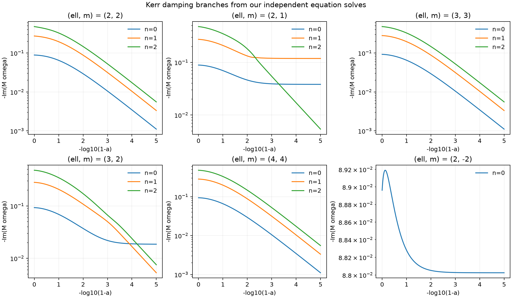
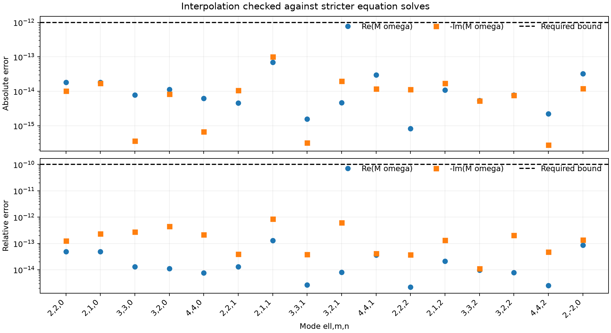

# Independently generated Kerr frequencies

This pass replaces the Cook-derived runtime tables and inherited signed-220
spectral coefficients with numbers computed by TorchWave's own radial/angular
Kerr eigenproblem solver. The solver, generator, interpolation code and generated
numerical data are original MIT work. Published mathematical equations supply
the method; no external QNM table, external QNM solver or waveform output
supplies a seed, training point or coefficient. External fixtures and LAL
binaries are used only after generation, for verification.

**All 16 generated branches passed their development, reverse-continuation and
stricter validation gates.** Runtime integration and final packaging checks
are recorded below.

## Method and reproducibility

The original [solver](../../../../scripts/kerr_leaver_solver.py) implements the
spin-weight minus-two radial continued fraction and angular spectral matrix
from [Cook and Zalutskiy, arXiv:1410.7698v2, Eqs. (23)–(44), (49)–(56)](https://arxiv.org/abs/1410.7698).
It uses outgoing radiation at infinity and ingoing radiation at the outer
horizon. Frequencies use M=1 and exp(-i omega t), with positive real part and
negative imaginary part. NumPy/SciPy provide generic linear algebra and root
finding; gmpy2 supplies generic extended arithmetic where required. No external
QNM implementation supplies these equations in code.

A large-angular-index Regge–Wheeler WKB estimate starts each Schwarzschild
overtone. Continuation in angular index establishes its low-ell label. Forward
spin continuation then follows that root with a secant predictor. Overtone labels
are continued, not reassigned by sorting damping rates. The independent review
checks recurrence substitution into the radial ODE, angular operator quadrature,
an alternative WKB homotopy, and continued-fraction inversion consistency.
See [solver derivation](pass-7-kerr-solver.md) and
[independent review](pass-7-kerr-solver-review.md).

The [generator](../../../../scripts/generate_kerr_qnm_independent.py) computes
16 branches: ell,m=(2,2),(2,1),(3,3),(3,2),(4,4), each with n=0,1,2, plus
(2,-2,0). Every branch covers 0 <= a <= 0.99999. Quintic splines use the
coordinate x=-log(1-a), with an initial 401-point grid and development-only
refinement to 801 or 1601 points. Midpoint development gates require both
absolute component error <=5e-13 and relative component error <=5e-11.

Once a grid is frozen, 100 pseudorandom points per mode use seed 20260912 plus
the canonical mode index. Six fixed checkpoints supplement them, and both
endpoints are checked separately. Some fixed points coincide with training
knots; they are not claimed to be disjoint holdouts. Validation recomputes the
equations at higher continued-fraction depth/angular truncation, with 160-bit
arithmetic on the near-extremal damped branches. These roots use the independent
spline as a starting guess, so they check numerical resolution at fresh
coordinates, not independently initialized mode identity. Both 1e-12 absolute
and 1e-10 relative component-error gates must pass. Validation points never
choose the spline density or coefficients.

A reverse continuation starts at the forward endpoint, then uses only its own
previous roots and a secant predictor. It must return along the same branch
within 5e-12 in complex frequency and close at Schwarzschild. Distinct overtone
labels must remain separated by more than 100 times the estimated root error
on a 1601-point coordinate grid. These finite checks support numerical accuracy
and branch continuity; they are not a rigorous error bound at every real spin.

Reproduce on a Python environment with TorchWave's `qnm-generation` optional
extra (SciPy and gmpy2, in addition to the normal dependencies):

```sh
OPENBLAS_NUM_THREADS=1 OMP_NUM_THREADS=1 python scripts/generate_kerr_qnm_independent.py \
  --output-dir /tmp/torchwave-qnm-independent-full \
  --points 401 --max-points 1601 --holdout-count 100
```

The generator stages its outputs and checks that its solver, generator and
runtime-template source hashes stayed unchanged. It never silently overwrites
the runtime. Exact inputs, versions, results and output hashes are archived in
[verification/pass-7](verification/pass-7/). The historical
`generate_kerr_qnm.py` entrypoint now invokes this independent generator;
`generate_kerr_qnm_author.py` only reproduces frozen historical reference
fixtures and cannot install author-derived runtime arrays.

## Runtime migration

`kerr_qnm_generated.dimensionless_qnm` evaluates the generated splines entirely
in Torch, with cached constants and no file reads or solver dependency. CPU/CUDA
use float64 working arithmetic; MPS uses float32, with coefficients centered at
their endpoint before conversion to preserve small near-extremal changes.
Tensor outputs retain shape, floating dtype, device and spin gradients.
Finite-domain checks run after promotion to the working dtype, so a
half-precision input of 1 cannot pass through a rounded upper bound. The strict
numerical certificate below applies to float64. MPS tests compare values and
individual spin derivatives with CPU float64 at seven identical representable
spins per mode, including both endpoints. Their separate float32 gates are
2e-6 relative for values and 1e-3 relative plus 1e-5 absolute for derivatives.

Kerr ringdown defaults to `qnm_backend="independent"`; the deprecated `"author"`
name and `kerr_qnm_author` module forward to this same implementation. The
optional printed Berti fits remain available. Published-equation EOB ringdown
also uses the new data. The signed-220 helper used by PhenomD and NSBH now
combines our positive/counterrotating roots and preserves the historical
clamp to [-0.9999,0.9999]. No inherited signed-220 coefficients remain.

Frozen Cook fixtures remain verification-only and retain their ODC-By notice.
Their old measured interpolation envelope describes the removed interpolant,
so it is not an accuracy target for our independently generated roots. The
existing external 5e-10 comparison bound is retained and extended to all stored
spins; new own-equation tests enforce the stronger dual gates above. The
historical signed-220 external reference and derivative tests are retained.
No catalog or waveform parity threshold is changed.

## Numerical results

Generation completed in 2925.61 s on `RONI2`. All three input
source hashes stayed unchanged. The final splines contain 14,416 training
points across the 16 modes, with 1,600 pseudorandom validation points, 96 fixed
checkpoints and 32 endpoint checks.

| (ell,m,n) | Training points | Max validation absolute error | Max validation relative error |
| --- | ---: | ---: | ---: |
| (2,2,0) | 401 | 1.832e-14 | 1.271e-13 |
| (2,1,0) | 801 | 1.837e-14 | 2.358e-13 |
| (3,3,0) | 401 | 7.772e-15 | 4.359e-13 |
| (3,2,0) | 801 | 1.132e-14 | 4.425e-13 |
| (4,4,0) | 401 | 6.217e-15 | 2.168e-13 |
| (2,2,1) | 801 | 1.071e-14 | 3.915e-14 |
| (2,1,1) | 1601 | 1.013e-13 | 8.479e-13 |
| (3,3,1) | 801 | 1.554e-15 | 3.804e-14 |
| (3,2,1) | 801 | 1.998e-14 | 7.601e-13 |
| (4,4,1) | 401 | 2.975e-14 | 4.185e-14 |
| (2,2,2) | 801 | 1.132e-14 | 3.726e-14 |
| (2,1,2) | 1601 | 1.718e-14 | 1.322e-13 |
| (3,3,2) | 801 | 5.440e-15 | 1.113e-14 |
| (3,2,2) | 1601 | 7.772e-15 | 2.060e-13 |
| (4,4,2) | 801 | 2.220e-15 | 7.945e-14 |
| (2,-2,0) | 1601 | 3.247e-14 | 1.378e-13 |

The largest validation component errors are **1.0133e-13 absolute** and
**8.4791e-13 relative**, conservatively rounded upward. The largest reverse
complex-frequency difference is **3.5592e-13**. The smallest overtone separation
is 0.00222254 in M*omega, more than 1.27e11 times the corresponding conservative
root-error estimate. Damping curves may cross while complex frequencies remain
distinct; labels follow Schwarzschild continuation rather than damping order.





The [generation report](verification/pass-7/qnm-generation-result.json) contains
per-channel bounds, worst spins, solver depths and library versions. The
[raw-solve archive](verification/pass-7/qnm-raw-solves.tar.gz) retains training,
development and reverse rows, including rejected coarser grids. Exact
[generation inputs](verification/pass-7/generator-inputs/) are preserved.

After generation, domain-guard and MPS working-arithmetic corrections were
applied to the runtime template. The generated numerical block was unchanged byte for byte:
SHA256 `507c490382f6c5e9a6bc9034a3c22d6d02e3cb240b5a42d8a70a7c1df50d5679`.
The [migration record](verification/pass-7/qnm-migration.json) separately hashes
the staged and installed files and describes these code-only corrections.

## Verification after generation

The focused QNM, device compatibility, PhenomD, ringdown, published-EOB driver
and hybrid-MECO suite passed **187 tests**, with one CUDA test skipped, in 4.04 s.
All 1,556 frozen Cook rows passed the unchanged external 5e-10 absolute bound;
the maximum observed difference was 8.97194e-13. The historical signed-220
reference contains 2,013 holdouts plus seven stricter solves. Maximum component
relative differences were 9.33066e-12 and 9.37597e-12, respectively, passing the
existing 1.1e-10 bound. These external values did not supply seeds or coefficients
and did not select interpolation density. See the
[external comparison record](verification/pass-7/qnm-external-check.json).

The complete ordinary suite passed **1,050 tests, with eight skipped, in
67.99 s**. Six skips require CUDA; two require generation-only gmpy2, absent
from the Torch test environment but available to the generator. MPS waveform,
QNM and gradient checks passed. The initial full run found the float64-on-MPS
regression; its failed log is retained in
[pre-mps-fix](verification/pass-7/pre-mps-fix/). The working-arithmetic fix
passed the original waveform device-parity test without changing its bounds.

The unchanged strict LAL catalog passes **11/21 cases** and frozen holdouts
pass **4/13**. Both retain valid inventories and no manifest drift, and both
commands correctly exit 1. Kerr component and TD waveform diagnostics execute
successfully but do not certify full waveform parity. See the
[current measurements](summary.md) for all cases and limits.

All 163 source, test, script and manifest hashes stayed unchanged throughout
the final five-command run. The
[verification record](verification/pass-7/verification-run.json) captures
commands, host, PID, timings, exit codes and hashes. A subsequent
[manifest metadata update](verification/pass-7/manifest-update.json) records
these results without changing model inventory or acceptance gates.

Wheel and source distributions built successfully. Their MIT license,
third-party notices and three QNM runtime modules match the working tree byte
for byte; the removed external/inherited runtime tables are absent from their
former modules. Artifact hashes and checked paths are recorded in
[package-check.json](verification/pass-7/package-check.json). Generation,
verification and build processes have completed. No commit or PR was created.

## Scope

This removes external numerical inputs from this Kerr-frequency asset. It does
not independently recalibrate PhenomD/XAS/XHM waveform shapes, remnants, matter
fits, approximate QNM formulas embedded in other published model calibrations,
or ROM teachers. Full waveform parity was not established by earlier passes
and cannot follow from a spectral replacement alone. See the
[remaining calibration inventory](pass-7-independent-calibration-inventory.md),
[direct hybrid-MECO solver](pass-7-independent-meco.md), and
[proposed own-NR pilot](pass-7-own-nr-pilot.md).
