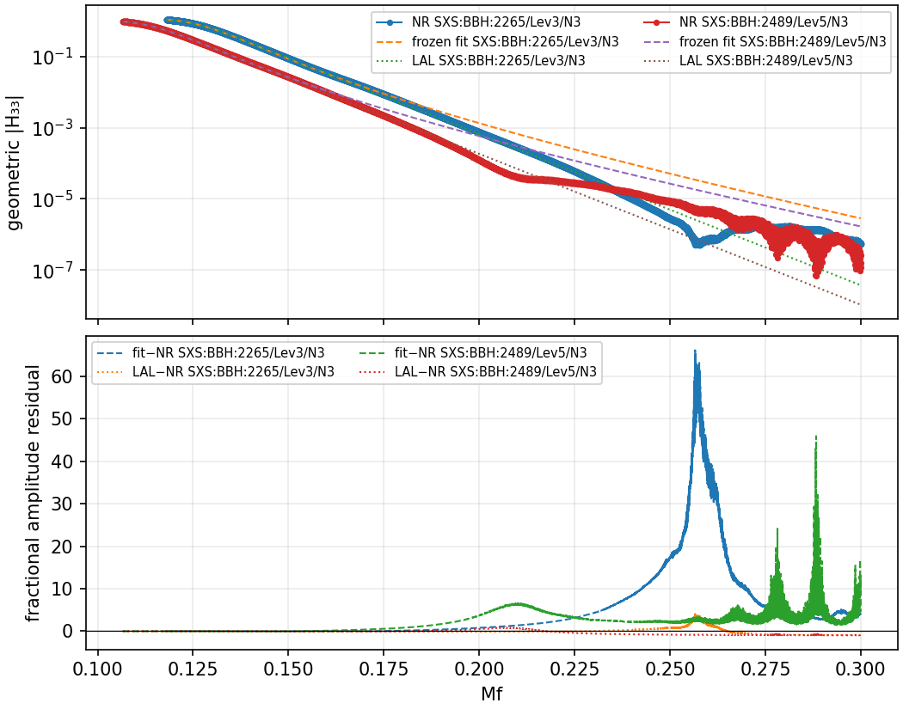

# Independent NR33 calibration: qualified and frozen

All seven numerical-relativity (NR) simulations pass the unchanged quality policy. An independent amplitude calibration was fitted to five training simulations, frozen, and then evaluated against the two held-out NR simulations and LAL. No external contact was made.

## Held-out results

| Approximate mass ratio | Fit vs NR | Fit vs LAL | NR vs LAL |
|---|---:|---:|---:|
| 3 | 0.6533% | 0.9056% | 0.5025% |
| 6 | 0.7974% | 0.5011% | 0.7743% |

These are relative amplitude L2 differences, `norm(A-B)/norm(B)`, on each held-out case's native frequency grid, from `0.95*f_ring_33` to `Mf=0.3`. LAL uses IMRPhenomXHM release 122022 via the public one-mode API, with positive-frequency mode argument `(3,-3)`. LAL 7.7.0 / LALSimulation 6.2.0 were used. Near-nonspinning NR is approximated as zero spin for that comparison.

The result supports sub-percent agreement for this nonspinning `(3,3)` amplitude slice. It does not establish full waveform parity, phase accuracy, spinning-system accuracy, or other modes. The percentages are integrated amplitude errors, not pointwise bounds: the low-amplitude high-frequency tails visibly disagree, with large fractional residuals. No complex-waveform or detector-weighted mismatch was evaluated. Two holdouts are a small validation set, and separate SXS IDs do not prove independence from all earlier simulation families or LAL's original training catalog.



## Data selection and quality

The [search plan](search-plan.json) and [candidate order](selection-round1.json) were frozen before new waveform downloads. The first replacements, **SXS:BBH:2489** at q≈6 and **SXS:BBH:2707** at q≈8, pass. The next q≈6 candidate, SXS:BBH:2164, was therefore not downloaded or screened. Historical failures remain in the previous experiment.

The five previously passing cases were reused with all 20 manifest rows unchanged. A fresh screen covered the combined 28 waveforms: two numerical resolutions and two extrapolation orders per simulation. Exact same-level metadata and source-file checksums were retained. The primary is the highest-resolution N3 waveform.

| q target | SXS BBH ID | Primary | Post-peak duration (M) | N2/N3 L2 | Resolution L2 |
|---|---|---|---:|---:|---:|
| 1.5 | 2331 | Lev3/N3 | 170.390 | 0.0130% | 0.0597% |
| 2 | 1166 | Lev3/N3 | 181.780 | 0.7123% | 0.1465% |
| 3 | 2265 | Lev3/N3 | 183.494 | 0.0058% | 0.4138% |
| 4 | 2485 | Lev5/N3 | 153.519 | 0.1729% | 0.0411% |
| 5 | 3619 | Lev3/N3 | 154.589 | 0.0217% | 0.1142% |
| 6 | 2489 | Lev5/N3 | 154.000 | 0.2046% | 0.2663% |
| 8 | 2707 | Lev4/N3 | 150.194 | 0.0130% | 0.0802% |

The original gates remain: post-peak duration ≥150M; extraction and resolution L2 ≤1%; preprocessing variations ≤0.2%; highest-resolution reference spin norm ≤1e-4; eccentricity ≤1e-3. The largest preprocessing difference is 0.00123%. q≈8 passes the duration gate narrowly, by 0.194M. For q≈6, the lower-resolution reference spin exceeds 1e-4; the frozen policy applies that physical-parameter gate to the primary, while the lower resolution supplies the numerical comparison. This is recorded in [discovery.md](discovery.md).

The [fresh catalog check](freshness.md) found the latest public snapshot byte-identical to the cached release and no extra eligible candidates. The [other-catalog review](other-catalogs.md) found no verified alternative satisfying all fixed requirements.

## Freeze and independence

- Training targets: q≈1.5, 2, 4, 5, 8. Holdouts: q≈3, 6.
- Unchanged numerical fitter and independent Kerr QNM solver; fixed sigma33=1.3 and degree-two parameter fits.
- Quality policy SHA-256: `1a863811b90c410cd5a9b0b52a0bd53696b869a0d503cb8fa61d9c054842138d`.
- Calibration SHA-256: `ade377c62a57a5d9cff513e34f22b0fe43677177a0c1577a9a4af5ad3b8aa561`.
- Fit completed at **2026-09-15 11:46:16 UTC**; LAL validation began at **11:46:34 UTC**. The calibration hash is unchanged before and after validation. No LAL output entered this fit or candidate selection.

The fit is an experimental artifact and has not been promoted into the runtime. The MIT `LICENSE`, all 139 snapshotted runtime files, all 37 historical files, all 15 v2 artifacts, and all four pipeline scripts are unchanged. Raw NR files and decoded NPZ files remain outside the repository. [Data attribution](DATA_ATTRIBUTION.md) records the source guidance and absent per-record license fields separately from the project's source license.

## Verification and reproduction

[verification.json](verification.json) confirms 24 new raw files against size, MD5 and SHA-256; all 28 decoded waveform hashes, finiteness, time ordering and measured peak durations; exact reuse of 20 rows; frozen training/holdout membership; input integrity; and independently recomputed held-out fit-vs-NR errors. [Luna's independent audit](independent-audit.md) checks the artifact relationships. The six focused NR33 test files passed: **39 tests**.

The full download command, host, PID and log path are recorded in [prepare-job.json](prepare-job.json). Run commands for calibration and validation are embedded in [the freeze](nr33-calibration-freeze.json) and [validation report](validation/nr33-validation.json). The merged manifest records both source manifests and hashes. To repeat screening, use a new output directory with the existing unchanged script:

```sh
PYTHONPATH=src python -m scripts.screen_nr33_calibration_v2 \
  --manifest docs/reviews/2026-09-15-independent-calibration-v3-search/nr33-manifest-round1.json \
  --policy docs/reviews/2026-09-15-independent-calibration-v2/quality-policy.json \
  --output /tmp/nr33-v3-recheck/quality.json \
  --qualified-output /tmp/nr33-v3-recheck/qualified.json
```

Raw caches currently reside under `/tmp/torchwave-nr33-v2` and `/tmp/torchwave-nr33-v3-search`; they are temporary and must be retained or re-fetched using the manifest URLs/checksums for future reproduction. The fit wrapper refuses existing output paths. `verify-run.py` similarly creates its verification report exclusively to preserve the recorded audit.

The next scientific step is broader validation with additional unused mass ratios, followed by phase, spin, and other-mode work before any general parity claim or runtime promotion.
