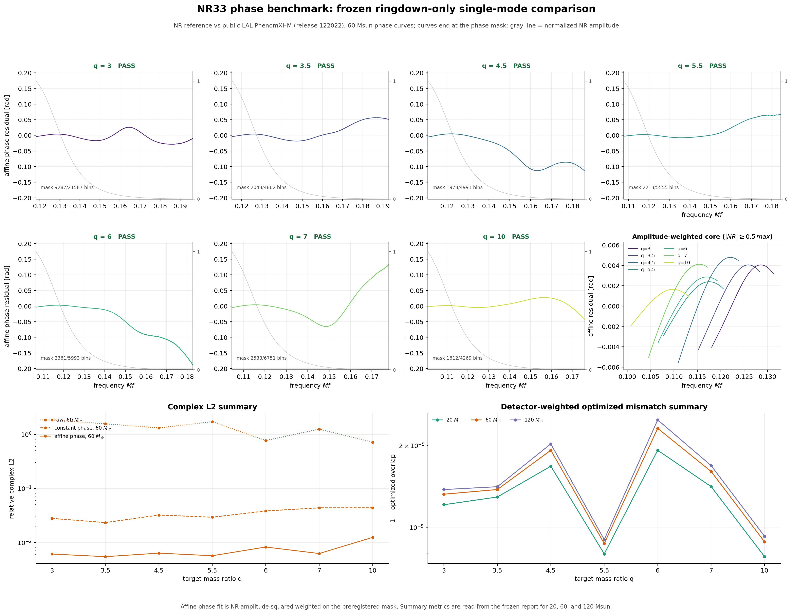

# Independent NR33 phase benchmark

**Most raw NR/LAL complex disagreement in this tested band comes from removable phase and time offsets.** All seven frozen holdouts pass the numerical phase-sensitivity gates. After alignment, the remaining NR/LAL weighted phase RMS is **0.00147–0.00475 rad** and complex relative L2 is **0.545–1.243%**.

This compares public LAL against independent NR data. **No independent phase model was fitted or validated, and no runtime provider was promoted.** The existing amplitude coefficients and MIT source license remain unchanged.

## Results

The phase and complex columns use the 60-solar-mass LAL call; aligned results agree across the three masses to numerical precision. Mass ratios are target labels; exact values, including q=9.98950857 for the final case, appear in [summary.csv](summary.csv).

| Target q | Raw complex L2 | Constant phase only | Phase + time L2 | Phase RMS (rad) | Fitted time (M) | PSD mismatch × 10⁶, 20 / 60 / 120 M☉ |
|---:|---:|---:|---:|---:|---:|---:|
| 3 | 185.45% | 2.789% | 0.610% | 0.003491 | -0.729 | 12.11 / 13.24 / 13.77 |
| 3.5 | 156.97% | 2.331% | 0.545% | 0.003477 | -0.609 | 12.93 / 13.77 / 14.10 |
| 4.5 | 131.63% | 3.216% | 0.634% | 0.004754 | -0.849 | 16.78 / 19.20 / 20.26 |
| 5.5 | 172.09% | 2.931% | 0.567% | 0.002068 | -0.778 | 7.99 / 8.72 / 9.01 |
| 6 | 77.03% | 3.827% | 0.824% | 0.002927 | -1.010 | 19.20 / 23.12 / 24.83 |
| 7 | 125.19% | 4.376% | 0.624% | 0.004126 | -1.179 | 14.12 / 16.05 / 16.87 |
| 10 | 71.49% | 4.385% | 1.243% | 0.001471 | -1.156 | 7.80 / 8.84 / 9.27 |

Complex L2 means `sqrt(∫|candidate−NR|² df / ∫|NR|² df)`, with no amplitude rescaling. Constant alignment maximizes the complex cross-correlation; affine alignment fits `c + 2π f Δt` using NR amplitude-squared weights. The signed time coefficient multiplies the candidate by `exp[i(c+2π f Δt)]`; it is a fitted convention offset, not a physical arrival-time measurement.

PSD mismatch is `1 − max_time,phase |overlap|`, normalized by both waveform norms. Values span **7.80×10⁻⁶ to 2.483×10⁻⁵** (0.000780–0.002483%). All 42 white/PSD maximizations are interior to the frozen ±200M window. A small normalized mismatch does not bound amplitude normalization error: at q≈10, the NR/LAL amplitude L2 is **1.233%**, accounting for almost all the **1.243%** aligned complex L2.

These are **one complex mode, nonspinning, ringdown-band-only** comparisons, not full detector waveform mismatches or full LAL parity. The band is `0.95 f_ring,33 ≤ Mf ≤ 0.3`; for example, q≈3 at 20 M☉ covers approximately 1198–3045 Hz. Constant/time alignment is allowed per case and cannot establish absolute inter-mode phase alignment.



[PDF figure](figures/nr33-phase-benchmark.pdf) · [Full machine report](results/report.json)

## What remains after removing offsets

Raw complex L2 ranges from 71% to 185%; constant phase alignment reduces it to 2.33–4.39%, and adding a time offset reduces it to 0.55–1.24%. The remaining phase curvature is small in the NR-weighted band. These measurements establish that gauge offsets dominate the raw difference; they do not uniquely attribute the residual to LAL's model.

In particular, q≈3 has a 0.00349 rad NR/LAL residual versus a 0.00301 rad inter-resolution sensitivity; q≈6 has 0.00293 versus 0.00226 rad. Those cases do not support confidently assigning the entire residual to analytical model error. Resolution differences are diagnostics, not rigorous error bounds; two resolutions alone do not establish an asymptotic convergence rate.

## Numerical controls

Each primary is the highest-resolution N3 waveform, with highest-resolution N2 and the next-resolution N3 as separate controls. The lower-resolution N2 combination is retained as an additional diagnostic. Preprocessing repeats halve `dt` and double the end taper. Every selected case remains reported.

| Target q | Extraction phase RMS | Resolution phase RMS | Max preprocessing phase RMS | Max extraction/resolution complex L2 | Gates |
|---:|---:|---:|---:|---:|---|
| 3 | 0.000039 | 0.003015 | 9.99e-07 | 0.5101% | Pass |
| 3.5 | 0.000022 | 0.000160 | 4.53e-06 | 0.1944% | Pass |
| 4.5 | 0.000044 | 0.001364 | 1.04e-05 | 0.2973% | Pass |
| 5.5 | 0.000096 | 0.000464 | 1.16e-05 | 0.1683% | Pass |
| 6 | 0.000085 | 0.002257 | 7.26e-06 | 0.3503% | Pass |
| 7 | 0.000030 | 0.001502 | 8.19e-06 | 0.2588% | Pass |
| 10 | 0.000236 | 0.000585 | 2.27e-07 | 0.1638% | Pass |

The preregistered limits are 0.01 rad and 1% aligned complex L2 for extraction/resolution, and 0.002 rad and 0.2% for preprocessing. Maximum preprocessing complex L2 is 0.00167%. Passing means stability under these controls, not a proof of absolute phase accuracy.

Phase fitting stops at the first NR amplitude below 10⁻³ of its band peak. Depending on the case, support ends at Mf≈0.176–0.196 and retains at least **99.9999468% of the unweighted NR squared norm**. Complex L2 and both overlap calculations retain the full common band, including the weak tail. Thus large pointwise tail excursions can coexist with small weighted summaries.

## Convention, provenance and verification

- The published Fourier convention and equatorial symmetry fix the positive-frequency mapping as `−FFT(conj(h33))`; each NR record is referred to its own h22 peak. See the [method review](method-review.md) and [IMRPhenomXHM Sec. II.1](https://arxiv.org/html/2001.10914v2#S2.SS1). No sign was selected using model residuals.
- A [decoded SXS convention check](convention-check.json) records a 4.83×10⁻⁴ relative L2 deviation from the ideal ±m identity for one near-nonspinning case. This verifies the approximate sign relation for that record; it is not an additional global error bound.
- [Protocol](protocol.json), [28-waveform input manifest](input-manifest.json), and [participating source hashes](source-freeze.json) were frozen before the first NR/LAL run. The new complex transform reproduces the old amplitude spectrum for every primary.
- LAL 7.7.0 / LALSimulation 6.2.0 uses the public `SimIMRPhenomXHMFrequencySequenceOneMode`, release 122022, mode `(3,-3)`, and public `SimNoisePSDaLIGOZeroDetHighPower`. Its outputs are validation artifacts only. Tiny NR spin residuals are approximated as zero.
- **72 tests pass**: [test log](logs/tests.log). They cover complex extraction, epoch translation, gauge recovery, amplitude weighting, full-band tail handling, a dense-grid overlap oracle, boundary detection, and the existing amplitude/provenance adapters.
- An [independent saved-array audit](results/audit-results.md) replays the numerical metrics without calling the frozen metric implementation. [Final integrity checks](verification.json) record the input/source/output hashes and preservation of the 677 baseline files.
- The prior expanded-data inventory incident is carried forward explicitly: its original full-inventory bytes remain unavailable. This benchmark uses the checksum-consistent replay, whose selections and waveform bytes matched the originals. See the [prior incident and replay](../2026-09-15-independent-calibration-expanded/README.md#provenance-incident-and-replay). The new freeze does not recover the lost original inventory.
- See [data attribution](DATA_ATTRIBUTION.md). Raw and decoded caches remain outside the repository; the benchmark saves derived complex arrays and comparison outputs. No authors or maintainers were contacted.

## Reproduction and next work

[Job metadata](job.json) records the exact command, environment, PID and log. The run completed on RONI2 in approximately 6.5 seconds. Use a fresh output directory for replay:

```sh
PYTHONPATH=src /Users/xangma/miniconda3/envs/pycbcorig313/bin/python \
  -m scripts.run_nr33_phase_benchmark \
  --protocol docs/reviews/2026-09-15-independent-phase-benchmark/protocol.json \
  --manifest docs/reviews/2026-09-15-independent-phase-benchmark/input-manifest.json \
  --source-freeze docs/reviews/2026-09-15-independent-phase-benchmark/source-freeze.json \
  --output /tmp/nr33-phase-replay
```

The [next-phase plan](next-phase-plan.md) identifies the missing clean `(3,3)` phase evaluator and coefficient input contract. Next: qualify the existing **training** waveforms for phase, then fit an independent phase shape from NR using the public analytical form. Keep all seven cases here as holdouts, preserve the amplitude freeze, and freeze the phase recipe before fitting. Lower-q coverage, q≈10 amplitude extrapolation, spins, other modes, inter-mode alignment, and full-waveform validation remain separate gaps.
