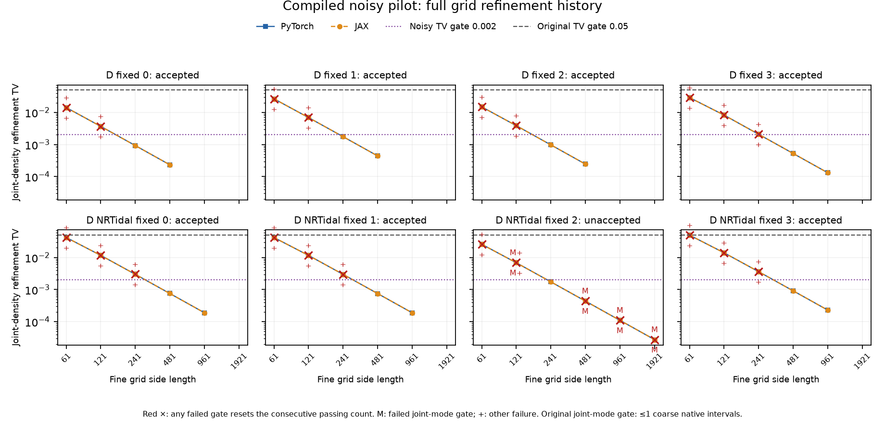
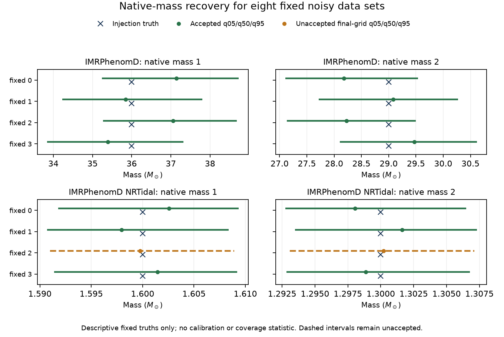

# Compiled noisy reference pilot

**2026-10-01 outcome: seven accepted noisy references; one unresolved mode gate.
All eight trials are terminal; no sampler or calibration qualification.**

The `compiled-pilot-v1` experiment tests numerical posterior
construction for the eight fixed-truth datasets from the
[original noisy experiment](noisy-calibration.md). It uses compiled JAX and
finer grids under the original scientific gates. The original timeouts remain
separate retained outcomes. No sampler or prior-drawn ensemble was executed in
this pilot, so it cannot establish calibration.

The [compact receipt](parameter-estimation-compiled-noisy-20261001.json)
binds the frozen protocol, terminal outcomes, independent verification and
externally retained full report and figures.

## Frozen design

The two free parameters are native component masses; all other waveform
parameters remain fixed. The models, fixed truths, independent uniform native
priors, noise seeds and per-model amplitude scales match the original noisy
experiment. Masses are in solar masses.

| Model | Fixed truth `(mass1, mass2)` | Native priors | Four fixed-trial noise seeds |
| --- | --- | --- | --- |
| PhenomD | `(36, 29)` | `[33, 39] × [26, 32]` | 610101–610104 |
| NRTidal v1 | `(1.6, 1.3)` | `[1.59, 1.61] × [1.29, 1.31]` | 620101–620104 |

H1/L1 data use matched Gaussian noise and the same effective PSD in generation
and analysis. The fixed per-model waveform amplitude gives noiseless network
SNR 20 at the fixed truth. Data-only chart discovery, the full rectangular native
prior, chart Jacobian and matched-noise audit settings are unchanged.

Execution uses CPU FP64 and chunks of 128. Torch and the OMP/MKL/OpenBLAS
thread settings are one; each trial has a separate four-core affinity.
JAX retains its own runtime thread pools.
Native Torch and compiled native JAX evaluate paired grids with
31, 61, 121, 241, 481, 961 and 1921 nodes per chart coordinate. JAX JIT is required;
eager fallback fails the trial. Each trial has a 3600-second reference budget
and a 3900-second external trial limit, with no automatic extensions or
replacement trials.

The [original scientific gates](noisy-calibration.md#frozen-experiment) are
unchanged. Acceptance requires two consecutive passing refinements in both
frontends, frontend parity and the discovery peak check. A failed refinement
resets the passing count. The mode gate concerns coordinates of the grid's
joint native-likelihood maximum. Independent Gauss-Legendre integration uses
fresh native Torch likelihood evaluations with declared orders 64, 128, 256 and 512; both
grid-versus-Gauss agreement and order-to-order convergence must pass. Gauss
agreement does not replace the grid quantile or truth-CDF checks.

Both matched-noise audits passed. These checks confirm the declared
noise-generation convention; an accepted posterior reference additionally
requires every numerical gate below.

## Trial results

Seven trials pass every required reference gate. NRTidal fixed index 2 completes
the entire ladder but fails the mode gate, so the aggregate outcome is
`failed_noisy_reference_pilot`. All eight independent Gauss audits pass at
64 → 128; integration agreement does not replace the failed grid gate.

| Model | Fixed index | Final grid side | Consecutive passes, each frontend | Gauss orders | Trial seconds | Outcome |
| --- | ---: | ---: | ---: | --- | ---: | --- |
| PhenomD | 0 | 481 | 2 | 64 → 128 | 141.61 | Accepted |
| PhenomD | 1 | 481 | 2 | 64 → 128 | 142.90 | Accepted |
| PhenomD | 2 | 481 | 2 | 64 → 128 | 139.68 | Accepted |
| PhenomD | 3 | 961 | 2 | 64 → 128 | 363.11 | Accepted |
| NRTidal v1 | 0 | 961 | 2 | 64 → 128 | 563.80 | Accepted |
| NRTidal v1 | 1 | 961 | 2 | 64 → 128 | 570.48 | Accepted |
| NRTidal v1 | 2 | 1921 | 0 | 64 → 128 | 1975.34 | Unresolved joint mode |
| NRTidal v1 | 3 | 961 | 2 | 64 → 128 | 562.21 | Accepted |

Trial seconds are canonical total elapsed times, including discovery and Gauss
audits. The eight jobs ran concurrently: controller wall time was 1979.30 seconds
(32.99 minutes), including process startup, versus 4459.12 seconds summed over
the parallel trials. No trial reached its deadline.

Fresh verification of all 46 retained paired grids confirms identical chart
coordinates, finite FP64 likelihoods and normalized posteriors. The maximum
absolute Torch/JAX log-likelihood difference is `3.5350e-9`, passing
`atol=1e-7`, `rtol=1e-8`; maximum frontend posterior TV is `1.0404e-11`
against `1e-5`. Every JAX reference used JIT without fallback.
Final Gauss-versus-grid TV ranges from `8.4286e-6` to `1.5702e-4` against
`0.002`; order-to-order TV-estimator drift ranges from `7.7305e-7` to
`1.6829e-5` against `0.00025`. The receipt retains the other numerical gates,
failed refinements and native posterior summaries.

The TV curves show integration refinement. Red crosses mark every failed
comparison; `M` identifies a mode failure. Low TV alone does not establish
reference acceptance.

These are descriptive native marginal 5%, 50% and 95% quantiles. The dashed
orange NRTidal index-2 intervals come from its unaccepted final grid. Its mass-1
marginal remains prior dominated (`KL=0.000637` nats), with a 90% width of
`0.017917` solar masses, about 89.6% of the declared prior span. Numerical
convergence and parameter identifiability are separate questions.

An accepted fixed-truth reference supports numerical construction of the
declared two-mass posterior for its particular same-model Gaussian-noise
dataset. Four noise repeats per model do not form a prior-predictive calibration
ensemble. Their truth-CDF percentiles are descriptive; no calibration screen,
coverage qualification or sampler result follows from this pilot. Physical
waveform accuracy, real-detector noise robustness and full-dimensional PE
remain outside its scope.

### Joint-mode grid alignment

NRTidal fixed index 2 fails the native mass-1 joint-mode gate at
241 → 481, 481 → 961 and 961 → 1921. The coordinate displacement halves from
`2.0833e-4` through `1.0417e-4` to `5.2083e-5` solar masses, but the coarse
native interval also halves: all three shifts are 2.5 intervals against a
limit of one. Each failure resets the consecutive passing count to zero.

The grid maximum alternates around the data-only discovery maximum while
its log-likelihood deficit shrinks from `1.2015e-5` through `3.4470e-6` to
`6.6893e-7` to `2.8878e-7`. At 961 → 1921 the joint-density TV is
`2.7550e-5`, native mean drift is at most `1.78e-8` of the 90% interval
width, native quantile drift is at most `7.64e-9` of that width, and
truth-CDF drift is `1.8128e-9`.
Stable posterior integration does not imply a stable grid argmax.

Both frontends select the same modes, and retained arrays confirm that all
eight datasets exactly match the original experiment. The observed pattern
supports lattice alignment along a narrow curved ridge with weak variation
along its length as the leading explanation. On the final grid, the best and
second-best retained nodes differ by `3.8015e-7` in log likelihood, far above
the `1.1369e-13` FP64 spacing near that peak and the measured frontend
differences. This is not an exact floating-point tie. It does not support a
frontend disagreement or noise redraw. This diagnosis does not waive the
frozen mode gate or turn the unresolved reference into an acceptance.

NRTidal fixed index 2 therefore remains an unresolved reference in this pilot.
No sampler or calibration result is inferred from its otherwise stable posterior
summaries.

## Reproducibility

Execution used `len`; the frozen source archive and protocol below identify the
exact executed experiment.

| Frozen artifact | SHA256 |
| --- | --- |
| Source archive `source-compiled-pilot-v1.tar.gz` | `d988d0301ba5e6461ca07359971480d248fcb5cef4bd10e35f4f9a0b9a82ceee` |
| Protocol `noisy_protocol.json` | `fdf2330044415bad81a27581bf82d01bd6d1f56acaafd9480e1c75bc0d207d25` |

The artifact bundle `diffgw-pe-compiled-pilot-20261001` retains bulk arrays,
full receipts and the executed source snapshot. The linked compact receipt binds
the retained files by hash. The bundle is retained evidence, not a public
downloadable archive.
