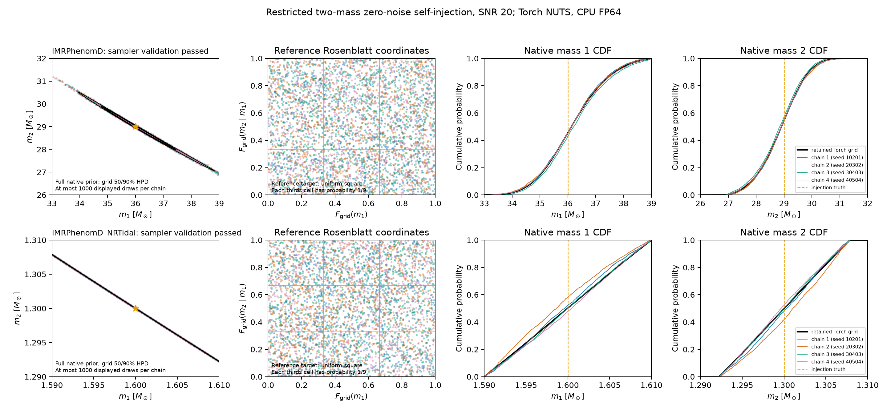
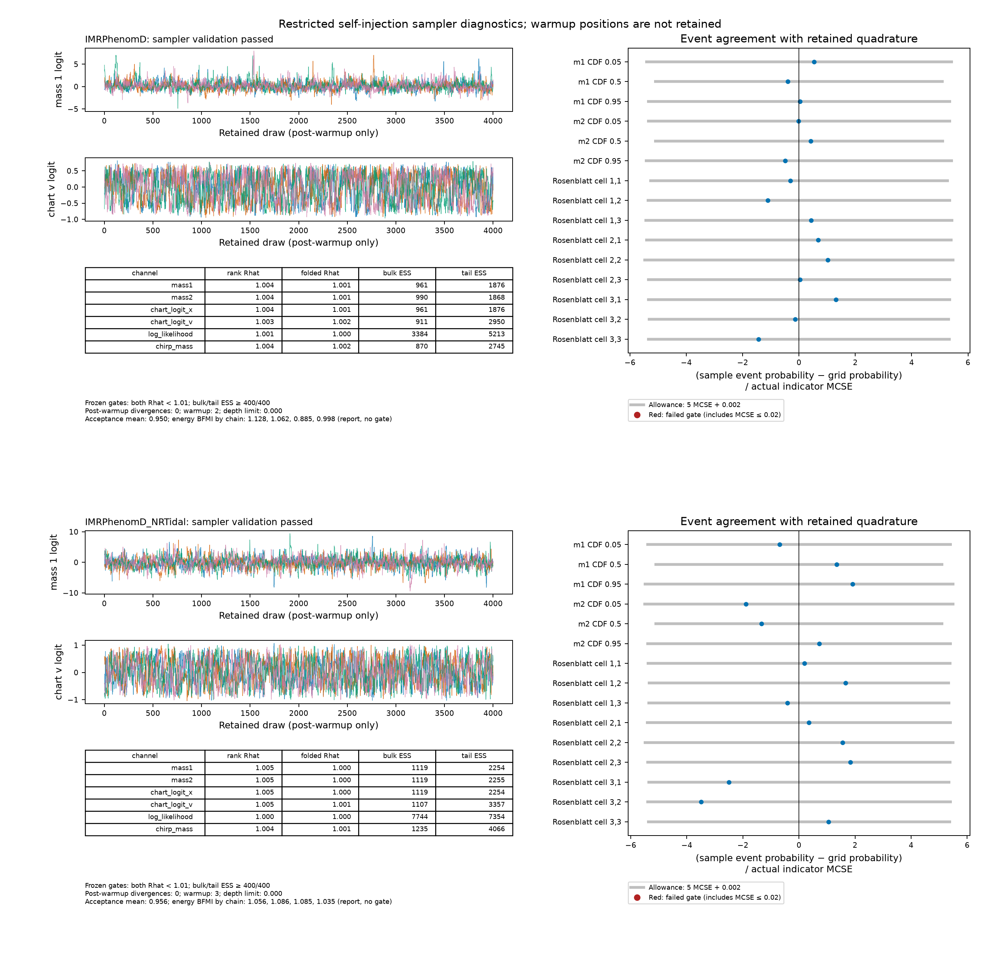

# Native Torch sampler validation

This 1 October 2026 experiment compares native Torch NUTS with the converged
[NRTidal/PhenomD quadrature baselines](nrtidal-convergence-pilot.md). It tests
two free component masses in CPU FP64, zero-noise SNR-20 H1/L1 self-injections.
Spins, tides and extrinsic parameters remain fixed. The same original data,
PSDs, frequencies, amplitude scales and full rectangular native priors are
retained. This experiment supplies no independent physical-accuracy,
full-dimensional PE, noisy-coverage or JAX-sampler claim.

## Target and preflight

The sampler uses the existing native dense detector-network Whittle likelihood;
it introduces no compressed likelihood or waveform correction. The pilot's
mass1/sinh conditional-mass2 chart covers the full original prior. The logistic
function maps unconstrained logits to the open unit square.
The log target includes the exact native uniform-prior density and both chart
Jacobians. A fixed, differentiable Newton solve follows the positive chirp root.

Both cases pass eight preflight points: smooth/NumPy chart agreement, native
Torch/JAX log-target and gradient agreement, finite-difference gradients, finite
states, and compiled/eager Torch value/gradient agreement. Fresh native Torch
likelihoods also reproduce seven nodes each from the retained 241 grid and
independent order-128 Gauss quadrature. The largest absolute discrepancy is
below 1e-7. Compilation is selected explicitly by the successful preflight;
production does not silently switch execution strategies.

The native NUTS sampler uses momentum draws consistent with the supplied diagonal
inverse mass matrix and the averaged adapted step size after warmup. Invalid
proposals are rejected and recorded as divergences. Outer candidate selection
and final-doubling adaptation follow
[Hoffman & Gelman's Algorithm 6](https://jmlr.org/papers/volume15/hoffman14a/hoffman14a.pdf).

## Frozen sampler checks

Each case has four independently seeded chains: 10201, 20302, 30403 and 40504.
Interior initial positions use truth logits plus independently seeded normal
offsets; no reference posterior draws are fitted or used for initialization.
The fixed diagonal metric uses prior-logit and truth conditional-curvature
scales. Each run binds source/runtime, original data, reference arrays,
preflight, seeds, metric, settings and gates in a SHA256-bound frozen protocol.

The following gates were fixed before the first production runs and remain
unchanged in the separately frozen follow-up:

- Finite rank/folded R-hat below 1.01, and bulk/tail effective sample sizes
  at least 400, for both native masses, both chart logits, dense log likelihood
  and chirp mass.
- No retained divergences; at most 1% retained transitions stopped by the
  depth cap; finite transition diagnostics.
- Native mean discrepancy at most five actual mean Monte Carlo standard
  errors (MCSE) plus 0.5% of the reference 90% interval width. Mean MCSE must
  be at most 2% of that width.
- Native 5%, 50% and 95% quantile discrepancies at most 3% of the reference
  90% width, with quantile MCSE at most 2% of that width.
- Six native CDF cutoffs and nine joint Rosenblatt cells: discrepancies at
  most five MCSE of the actual tested indicator plus 0.002 quadrature allowance;
  finite positive indicator MCSE at most 0.02. A zero-variance indicator fails.

The Rosenblatt map uses the retained grid's mass1 marginal and conditional
mass2 CDF; its nine cells each have reference probability 1/9. This checks joint
structure as well as marginal probabilities. The 0.002 allowance exceeds both
cases' final refinement and independent Gauss/grid joint-density TV. No KDE
bandwidth or sample/grid TV is used as an acceptance test. ArviZ 0.22.0 computes
diagnostics on the actual tested functionals. Nonfinite statistics fail and
remain explicit null values in JSON. Per-chain energy BFMI is reported with a
0.3 warning threshold, separately from the outcome gates. See the
[Stan diagnostic guidance](https://mc-stan.org/learn-stan/diagnostics-warnings.html)
and [ArviZ ESS API](https://python.arviz.org/en/v0.22.0/api/generated/arviz.ess.html).

## Initial results and bounded follow-up

The first runs used 500 warmup and 1,000 retained draws per chain, target
acceptance 0.8 and maximum depth 8. Both failed the original gates. Passing joint
cells or near-reference estimates alone did not establish validation.

| Case | Largest rank/folded R-hat | Smallest bulk ESS | Smallest tail ESS | Retained divergences | Largest native median-CDF MCSE | Runtime on len |
| --- | --- | --- | --- | --- | --- | --- |
| IMRPhenomD | 1.02650 | 212.4 | 504.0 | 3 | 0.02724 | 417.8 s |
| IMRPhenomD_NRTidal | 1.01033 | 248.7 | 593.4 | 2 | 0.02787 | 457.7 s |

Both cases had zero depth-cap terminations, finite diagnostics, no BFMI warnings
and passing checks for all nine joint cells. Native-mass median probabilities
failed their MCSE ceiling; several mean/quantile checks also failed precision or
discrepancy limits. Correlated chart coordinates and occasional divergent
transitions motivate a single bounded follow-up, without changing the target.
Saved positions around divergences are accepted states; they do not identify
the rejected leapfrog endpoints or prove the cause of the divergence.

The separately frozen follow-up retains the source, seeds, chart, diagonal
metric, reference distribution and gates. It uses 1,000 warmup and 4,000 retained
draws per chain, target acceptance 0.95 and depth 8. It evaluates all gates at
the fixed endpoint, retains the failed initial results, and pools no initial
draws. Each case has a 30-minute execution cap and no automatic extension.

Both follow-up runs pass every frozen gate at the fixed endpoint, using only
their own 16,000 retained draws per case:

| Case | Largest rank/folded R-hat | Smallest bulk ESS | Smallest tail ESS | Retained divergences | Largest indicator MCSE | Runtime on len |
| --- | --- | --- | --- | --- | --- | --- |
| IMRPhenomD | 1.00404 | 870.1 | 1,868.2 | 0 | 0.01383 | 1,003.3 s |
| IMRPhenomD_NRTidal | 1.00464 | 1,107.3 | 2,254.0 | 0 | 0.01320 | 1,184.2 s |

Both have zero retained depth-cap terminations and no BFMI warnings. Warmup
has two and three divergences respectively, reported separately from the
retained samples. All six native CDF cutoffs and nine joint cells pass for each
case. The largest native quantile discrepancy is 0.55% of the reference 90%
width for PhenomD and 1.86% for NRTidal, below the fixed 3% limit. Mean and
quantile precision checks also pass.

The first recorded transitions took 163.3 s and 171.7 s, including startup,
compilation and step-size initialization; those costs are included above.
The subsequent transitions completed steadily. Each model finished within its
30-minute cap, in 16.7 and 19.7 minutes respectively.

Native sample scatter and grid 50%/90% highest-density contours use the full
original prior axes. Chainwise native CDFs use all retained draws. The joint
Rosenblatt panels show the frozen equal-probability cells.

Trace plots show retained logits for all four chains. The table reports all six
mixing channels; event residuals use each tested indicator's actual MCSE.
Grey bars show the frozen five-MCSE-plus-quadrature allowance. The separately
reported MCSE ceiling also contributes to each event's pass/fail outcome.

The [compact experiment receipt](parameter-estimation-sampler-20261001.json)
records exact outcomes, failed initial results, frozen settings, artifact hashes
and reproduction evidence.

## Reproducibility

The artifact bundle `diffgw-pe-sampler-20261001` retains chains, frozen protocols,
execution receipts and source snapshots. The linked compact receipt records
their hashes and binds the original data, quadrature references and sampler
settings. The bundle is retained evidence, not a public downloadable archive.

Executed `source-sampler-v3.tar.gz` has SHA256
`fe1d37c7bde63815a4431063d06876435d939b1c8afddd18e7ed541a572b99b1`.
Runtime: Python 3.12.3, Torch 2.14.0+cpu, JAX/jaxlib
0.11.2, NumPy 2.5.3, SciPy 1.18.1, ArviZ 0.22.0, float64/complex128 on len.
OMP, MKL and OpenBLAS each use one thread. CPU affinities are 32–35 and 36–39.

The retained frozen protocols identify the exact injection and quadrature arrays,
initial positions, inverse mass, seeds and execution settings needed to reproduce
the experiment.

Prior-dominated and prior-support-limited mass marginals remain limitations of
these bounded experiments. Successful sampling in these two cases does not
change waveform physical qualification gates or resolve the original campaign's
separate numerical failures.
