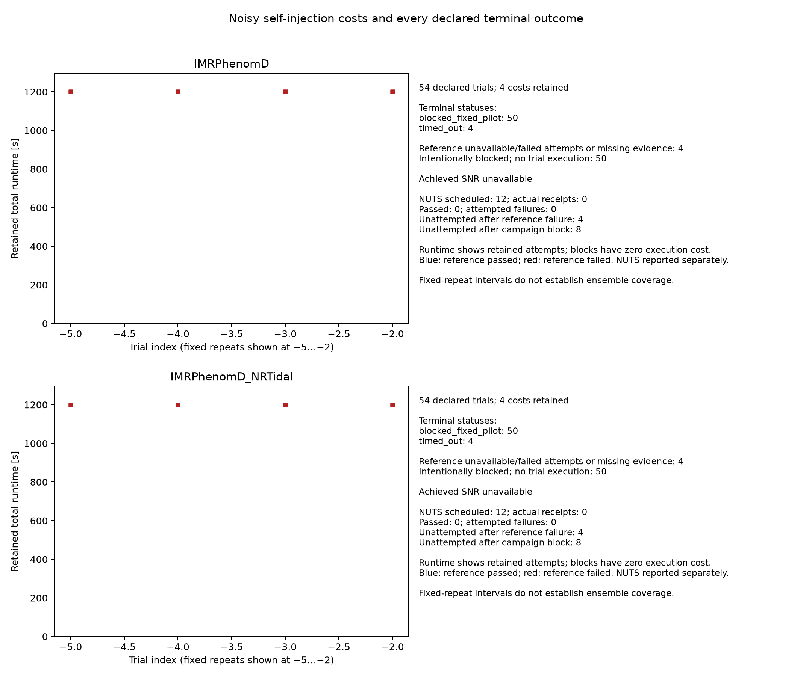

# Noisy recovery and finite-ensemble calibration

**2026-10-01 outcome: stopped after eight reference timeouts; no noisy recovery,
sampler or calibration qualification.**

The [curated receipt](parameter-estimation-noisy-20261001.json) records the
executed fixed-truth pilot, matched-noise audits, partial grids, blocked inventory
and retained evidence. This extends the
[common-data quadrature pilot](nrtidal-convergence-pilot.md) and
[native Torch sampler check](native-sampler-validation.md) to Gaussian noise for
`IMRPhenomD` and `IMRPhenomD_NRTidal`, CPU FP64, H1/L1 and two free native component
masses. All other waveform parameters remain fixed. Earlier zero-noise results
and physical qualification failures remain unchanged.

## Observed results and cost

Both matched-noise audits passed: 1024 realizations per model satisfied the
frozen five-standard-error moment and correlation checks. Torch/JAX likelihoods
agreed with the analytic residual value `-q/2` to within `3.5e-13`.
The audits took 5.62 seconds for PhenomD and 5.83 seconds for NRTidal.

All eight fixed-truth trials passed source-construction checks and completed
data-only chart discovery. Each then reached the 1200-second reference limit,
with terminal elapsed times of 1200.16–1200.22 seconds. Every trial completed
paired Torch/JAX grids through 241 × 241 and was evaluating the JAX 481 × 481
grid when stopped. Likelihood and posterior frontend parity passed on the
completed paired grids. Those partial grids are diagnostic evidence; none is
an accepted reference, and no independent Gauss audit or NUTS run began.

| Model | Fixed index | Noise seed | Reference seconds | Last 121 → 241 joint TV, JAX | Consecutive passing refinements, required two | Terminal status |
| --- | ---: | ---: | ---: | ---: | ---: | --- |
| PhenomD | 0 | 610101 | 1200.16 | 0.000932 | 1 | `timed_out` |
| PhenomD | 1 | 610102 | 1200.22 | 0.001761 | 1 | `timed_out` |
| PhenomD | 2 | 610103 | 1200.22 | 0.000980 | 1 | `timed_out` |
| PhenomD | 3 | 610104 | 1200.22 | 0.002096 | 0 | `timed_out` |
| NRTidal | 0 | 620101 | 1200.17 | 0.003006 | 0 | `timed_out` |
| NRTidal | 1 | 620102 | 1200.22 | 0.002997 | 0 | `timed_out` |
| NRTidal | 2 | 620103 | 1200.22 | 0.001752 | 1 | `timed_out` |
| NRTidal | 3 | 620104 | 1200.22 | 0.003639 | 0 | `timed_out` |

The TV column describes the last completed refinement, not the attempted 481
grid or a final baseline. No trial had two consecutive passing refinements at
241; four also exceeded the frozen joint-TV limit of 0.002 there.

The chart records terminal costs and the 100 blocked ensemble rows. Its SNR
labels are unavailable because no accepted posterior summary exists; retained
source checks separately record achieved noiseless SNR 20 for all eight trials.

The full inventory retains 108 entries: eight executed terminal trial receipts
and 100 intentionally blocked, unexecuted ensemble rows. Blocked rows cite the
verified fixed-pilot receipts; they have no fabricated trial receipt. The 24
scheduled sampler requirements produced zero sampler attempts and zero sampler
failures. Their lifecycle is *not attempted because the reference failed* or
*not attempted because the ensemble was blocked*; the raw pending status is
retained for provenance.

Calibration is unresolved. Every model/mass panel retains the declared
50-trial denominator, with zero usable truth-CDF percentiles and 50 unknown
outcomes. The unknown CDF and coverage envelopes are `[0, 1]`; no empirical-CDF
screen statistic or recovery/coverage result exists. Only the cost figure is
curated here.

## Numerical resolution

Reconstructing the retained **Torch-only**
121/241/481 posteriors with the original gates gives:

| Model | Fixed indices | 241 → 481 joint TV | Consecutive passing refinements through 481 |
| --- | --- | --- | --- |
| PhenomD | 0, 1, 2 | 0.000234–0.000442 | Two |
| PhenomD | 3 | 0.000527 | One |
| NRTidal v1 | 0, 1, 3 | 0.000755–0.000918 | One |
| NRTidal v1 | 2 | 0.000440 | Zero: mass1 mode drift fails |

NRTidal index 2's mass1 coordinate of the grid's joint native-likelihood maximum
shifts by 2.5 coarse-grid intervals, exceeding
the existing gate, although its mean and quantiles are stable. Only three of
eight Torch reconstructions have the required two consecutive passing
refinements. These reconstructions cannot supply the missing paired JAX 481
grid or independent Gauss audit, and do not change the original timeout
statuses. A faster likelihood alone cannot establish reference convergence.

## Frozen experiment

| Stage | Declared trials per model | Executed outcome |
| --- | --- | --- |
| Fixed-truth pilot | Four independent noise realizations at the previous truth | Four reference timeouts |
| Prior-drawn quadrature ensemble | 50 independent native-prior truths and noise realizations | All 50 blocked |
| Native NUTS | All four fixed trials and ensemble indices 0, 7, 14, 21, 28, 35, 42, 49 | All 12 requirements unattempted |

| Model | Fixed truth `(mass1, mass2)` | Independent uniform native priors | Prior seed | Ensemble noise seed base |
| --- | --- | --- | ---: | ---: |
| PhenomD | `(36, 29)` | `[33, 39] × [26, 32]` | 630101 | 640101 |
| NRTidal | `(1.6, 1.3)` | `[1.59, 1.61] × [1.29, 1.31]` | 630102 | 650101 |

Masses are in solar masses. The frozen inventory records each truth and noise
seed, with noise-audit seeds 600101/600102 and chain-seed root 660101. Keep the
per-model waveform amplitude scale fixed across all truths and templates. SNR
20 refers to the reference truth; prior draws are not rescaled or selected by
achieved SNR.

For the positive-frequency scalar-`df` dense Whittle likelihood, each independent
real and imaginary noise component has variance `PSD/(4*df)`, using the identical
effective floored PSD in generation and analysis. The PSD floor is `1e-50`; DC
and Nyquist bins are excluded. Retain data, PSDs, frequencies, amplitude scales
and seeds with their hashes. No realized noise draw is rejected for descriptive
residual statistics.

Each trial uses a 4097-point native-prior diagonal and the four highest
chirp-separated maxima to seed at most 24 Torch-autodiff L-BFGS-B starts:
60 iterations and 80 function calls per start, at most 1920 calls in total.
The chart scale requires five positive finite native-mass2 curvature estimates
with relative spread at most 0.05. This search leaves waveform physics and the
native rectangular prior intact.

The frozen grid ladder is 31, 61, 121, 241, 481 nodes per chart coordinate;
independent Gauss-Legendre orders are 64, 128, 256, 512. Retain the earlier native
quantile, width, mode, normalizer and resolution checks. The final two joint-TV
comparisons must each be at most 0.002, oversampling estimator drift at most
0.00025, and injected-truth CDF drift at most 0.002. Native mean and q05/q50/q95
changes must each be at most 0.005 of the fine-grid central 90% width. Final
independent Gauss density TV must be at most 0.002, with order-to-order TV drift
at most 0.00025. The grid maximum log likelihood must be within 0.05 of the best
discovery value. These are numerical checks, not rigorous bounds on error
against an unknown exact posterior.

The planned sampler configuration is four native NUTS chains, 1000 warmup
transitions and 4000 retained draws per chain, target acceptance 0.95, maximum
tree depth eight and the
[existing sampler gates](native-sampler-validation.md#frozen-sampler-checks).
Reference construction has a 1200-second limit and the complete trial a
3600-second limit, with one thread per task. Failures and timeouts remain in the
inventory without automatic extensions, truth redraws or replacement trials.

The unexecuted calibration screen uses continuous quadrature truth-CDF
percentiles, rather than finite posterior-draw SBC ranks. Under the matched
prior-predictive model and exact inference, these percentiles are uniform; fixed
truth repeats do not satisfy that ensemble condition. See
[Talts et al.](https://arxiv.org/abs/1804.06788). The four-panel simultaneous 95%
[DKW–Massart band](https://arxiv.org/abs/2403.16651) has half-width
`sqrt(log(160)/100) = 0.2252814643`, with a separate numerical CDF allowance of
0.002. It checks both jump limits of the empirical CDF. Central 50%/90% coverage
uses pointwise 95% exact Clopper–Pearson intervals. Missing outcomes retain all
50 in the denominator and conservative unknown-rank/count envelopes; any
reference failure leaves calibration unresolved. These small-ensemble screens
cannot prove exact calibration.

## Reproducibility

Execution used `len`, CPU
`float64/complex128` and one thread per task. Runtime was Python 3.12.3, Torch
2.14.0+cpu, JAX/JAXlib 0.11.2, NumPy 2.5.3, SciPy 1.18.1 and ArviZ 0.22.0.

| Frozen artifact | SHA256 |
| --- | --- |
| Scientific source archive `source-noisy-final-v1.tar.gz` | `3f43030ea6ebeb37576c2b7fbd027049a0e5f18d8dc3975dd0cb9ee3bf495e09` |
| Protocol `noisy_protocol.json` | `51020994f2b223a6d54289029c2003b40018729aa3791ddfc96581fdbe59e7ba` |

The artifact bundle `diffgw-pe-noisy-20261001` retains the original data, partial
posterior arrays, frozen protocol and executed source snapshot. The curated
receipt binds the full inventory, terminal outcomes and retained files by SHA256
and byte size. The bundle is retained evidence, not a public downloadable archive.

## Separate follow-up experiment

The [compiled noisy reference pilot](compiled-noisy-reference-pilot.md) freezes
a separate fixed-truth experiment with compiled execution, a finer frozen
ladder and independent Gauss checks.
NRTidal index 2's failing 481 refinement resets its count: with the existing
rule it needs passing checks at both 961 and 1921, so a ladder ending at 961
alone cannot resolve all eight trials. Its separate report records the finer
levels; the original timeouts and numerical failures remain unchanged.
No prior-drawn ensemble was executed in this experiment.
Same-model Gaussian-noise inference cannot establish independent
physical waveform accuracy, real-detector noise robustness, full-dimensional
PE or population calibration outside the declared prior.
