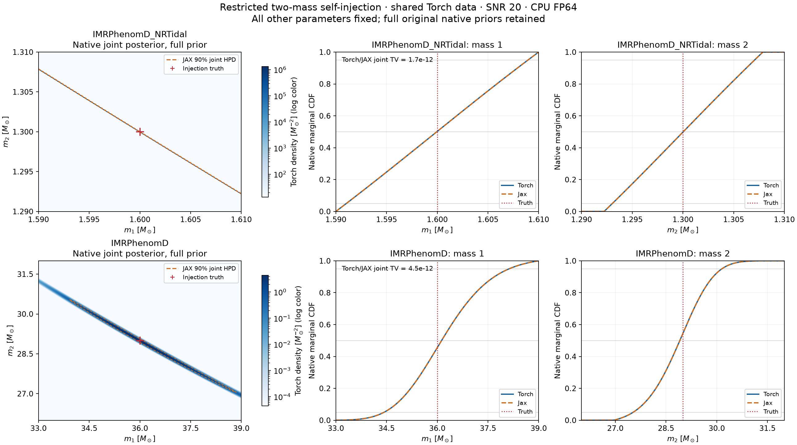
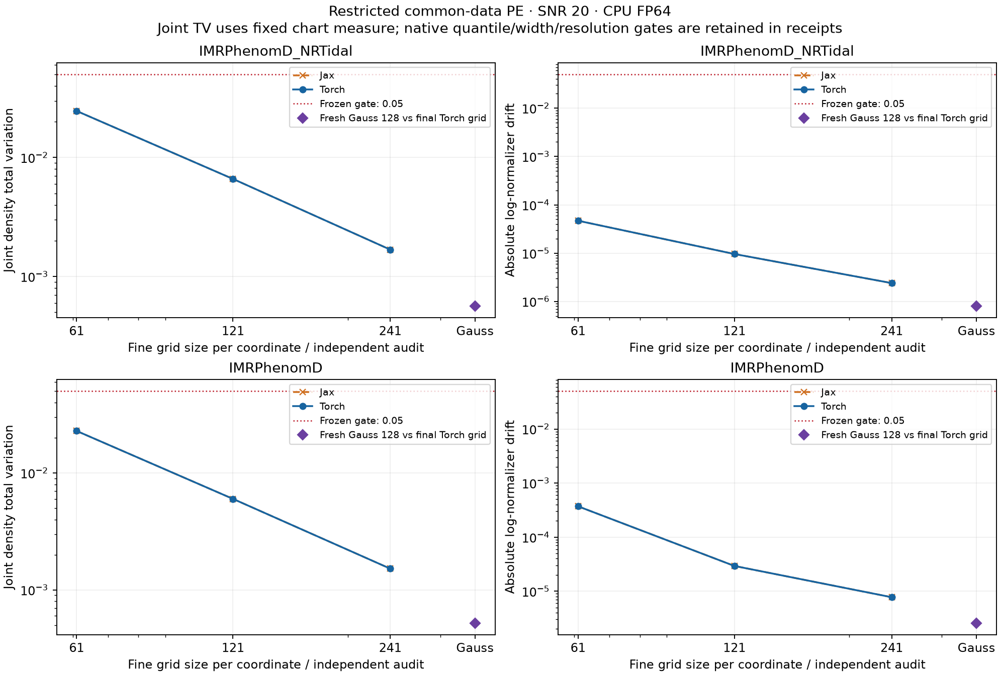

# NRTidal convergence and common-data PE pilot

On 1 October 2026, `IMRPhenomD_NRTidal` and the `IMRPhenomD` control completed
restricted two-mass numerical PE baselines in Torch and JAX at 241 nodes per
chart coordinate. Independent quadrature also passed. This establishes numerical
integration and frontend agreement for these cases; it supplies no independent
physical injection, sampler validation or coverage claim. NRTidal's first mass
remains prior dominated and prior-support limited.

The [original campaign](parameter-estimation-campaign.md) remains unchanged:
its NRTidal native rectangular grid was unresolved at 481 nodes per axis, with
joint TV about 0.466. This pilot changes integration coordinates while retaining
the original bounded posterior. Its separate protocol preserves the original
campaign counts and failed receipts.

## Frozen experiment

Both frontends consume the **same retained original Torch data**, PSDs,
frequency bins and amplitude scale, verified against original receipt hashes.
The experiment remains CPU FP64, zero noise, SNR 20, H1/L1 projection, two free
component masses and every other parameter fixed.

| Case | Truth masses, solar masses | Independent uniform native prior bounds | Frequency grid | Fixed chart scale, solar masses |
| --- | --- | --- | --- | --- |
| IMRPhenomD_NRTidal | 1.6, 1.3 | [1.59, 1.61] × [1.29, 1.31] | 30–512 Hz, df = 1 Hz | 1.5285226586348568e−5 |
| IMRPhenomD | 36, 29 | [33, 39] × [26, 32] | 20–400 Hz, df = 1 Hz | 0.031625357824682364 |

The chart uses native mass1 and a unit coordinate v. Its center c(mass1) follows
the constant truth chirp-mass curve. For scale s and native mass2 bounds L, U,
let a = asinh((L−c)/s) and b = asinh((U−c)/s). Then

\[
m_2=c+s\sinh(a+v(b-a)),\qquad
J=\frac{\partial m_2}{\partial v}=s\cosh(a+v(b-a))(b-a).
\]

This bijection covers the complete original rectangular prior, including exact
endpoints. Quadrature integrates likelihood times J divided by the native prior
area; the physical mode maximizes native likelihood. Native mass2 CDFs integrate
partial chart cells at inverse-mapped cuts. Scale is fixed before integration
from the median of five positive finite conditional curvature estimates, whose
relative sigma spread must be at most 0.05. It is not fitted to the posterior.

The predeclared schedule is 31, 61, 121, 241, 481. Pilot protocol v1 retains
the [original numerical thresholds](../inference.md#accept-a-bounded-posterior-result)
for joint TV, log normalizer, native quantiles, interval widths and mode drift.
Native spacing becomes the maximum span across all four corners of every
mapped chart cell, over the full prior. Additional requirements are:

- Two consecutive passing refinements in each frontend.
- At least four intervals across conditional-v 90% widths for rows within the
  native mass1 central 90% interval.
- Joint TV on factor-2 and factor-4 oversampled bilinear interpolants, with
  estimator drift at most 0.0025.
- Common-data likelihood agreement at every grid node (`atol=1e-7`,
  `rtol=1e-8`) and posterior TV at most 1e-5 at every grid.

Retained design v2 binds final preflights and these gates before production
integration; the earlier diagnostic design is retained. Design versions are
distinct from the numerical protocol version.

## Observed results

Final Torch refinement metrics are below; JAX also passes every gate. Runtime
includes both frontends per model, excluding preflight and plotting.

| Case | Passing refinements | Joint TV | Absolute log-normalizer drift | Torch/JAX posterior TV | Grid runtime on len |
| --- | --- | --- | --- | --- | --- |
| IMRPhenomD_NRTidal | 61→121, 121→241 | 0.00168340 | 2.40e−6 | 1.69e−12 | 96.5 s |
| IMRPhenomD | 61→121, 121→241 | 0.00151991 | 7.73e−6 | 4.54e−12 | 79.8 s |

NRTidal's 31→61 refinement failed native mass2 resolution despite passing TV;
that failure is retained. Maximum absolute Torch/JAX likelihood differences
across all evaluated grids were 2.43e−9 for NRTidal and 1.00e−9 for PhenomD.
Neither needed the scheduled 481 grid.

Full prior support is shown. NRTidal's narrow joint ridge coexists with broad
marginals. Torch/JAX CDF overlays agree, while the nearly uniform mass1 CDF
shows prior dominance. Native density includes the Jacobian conversion; color
is logarithmic. The joint contour is a grid-based diagnostic.

Fresh full-support tensor Gauss-Legendre quadrature evaluates new native Torch
likelihood nodes. Both cases pass at order 128 after comparison with order 64;
order 256 was available if needed. The audit requires log-normalizer differences
at most 0.05, native mean differences at most 5% of final 90% widths, relative
standard-deviation differences at most 5%, density TV at most 0.05, and
TV-estimator order drift at most 0.0025. It checks both agreement with the
trapezoidal baseline and Gauss-order refinement.

| Case | Gauss/grid joint TV | Absolute log-normalizer difference | Largest relative standard-deviation difference | Audit runtime |
| --- | --- | --- | --- | --- |
| IMRPhenomD_NRTidal | 0.00056385 | 7.99e−7 | 1.61e−5 | 5.8 s |
| IMRPhenomD | 0.00052139 | 2.58e−6 | 3.40e−6 | 3.0 s |

The Gauss point compares independent quadrature with the final grid; it is not
another trapezoidal grid size. Every refinement and gate is retained in receipts.
NRTidal mass1 marginal KL is 0.0002465 nats, below the declared 0.01 diagnostic;
its outer prior-edge masses are about 4.85% and 4.75%. PhenomD mass1 is also
prior-support limited, with about 1.18% in its upper outer 5% prior band.
Convergence does not remove these limitations. Tides, spins and extrinsics were
fixed. Physical qualification gates retain their existing outcomes.

## Reproducibility

The [machine-readable record](parameter-estimation-pilot-20261001.json) contains
summaries, refinement/parity history, source/runtime binding and executor hashes.
The artifact bundle `diffgw-pe-pilot-20261001` retains bulk arrays, full receipts
and the executed source snapshot. The record identifies these retained files by
hash; the bundle is not a public downloadable archive.

Executed archive `source-pilot.tar.gz` has SHA256
`7d220096be0acb5836cf494bca9505c6cb71e1673f7fbd9dc31830e1a6d8cce9`;
executed pilot runner SHA256 is
`689f8cb23a068b422a3f60e7058ea3c3a77d4bb94ce93760277ccade97d95775`.
These hashes identify the executed snapshot and runner.

The retained protocol and execution records bind the original data, chart scale,
Python 3.12.3 environment, thread settings and CPU affinity (32–39). Optional JIT
was not used. Waveform source bytes match the original campaign snapshot.

This baseline supports the separately frozen
[native Torch sampler check](native-sampler-validation.md) on the same bounded
posterior. Broader parameter recovery and independent physical injections remain
further experiments with their own numerical uncertainties.
