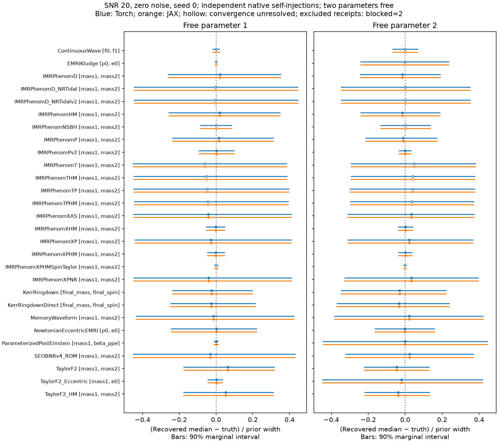
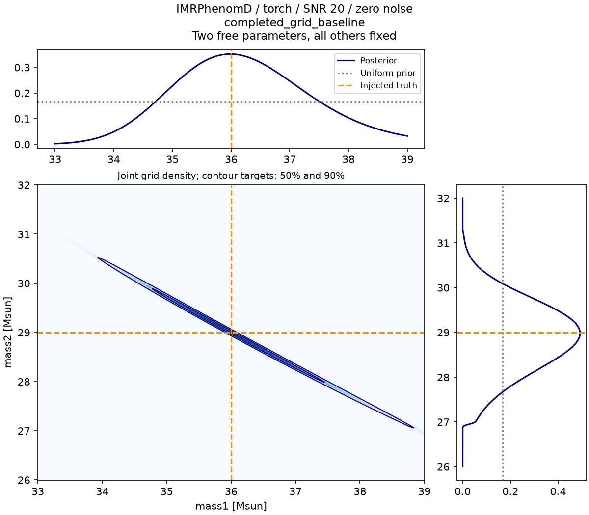
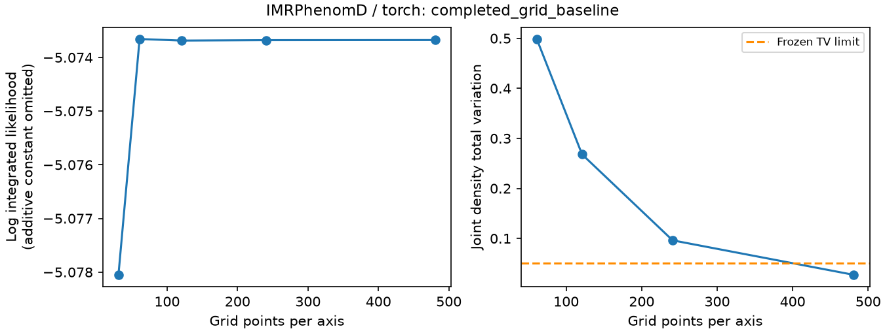
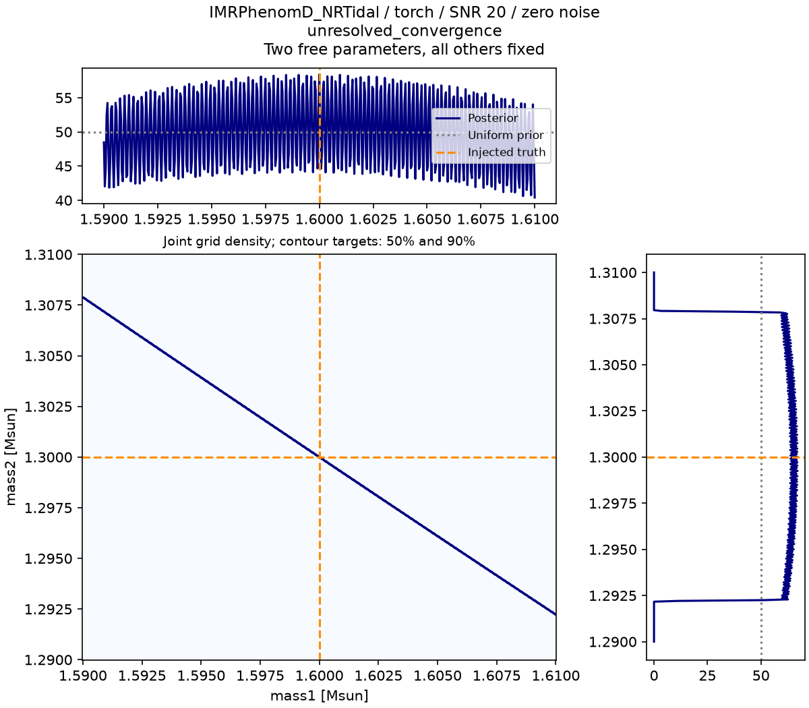
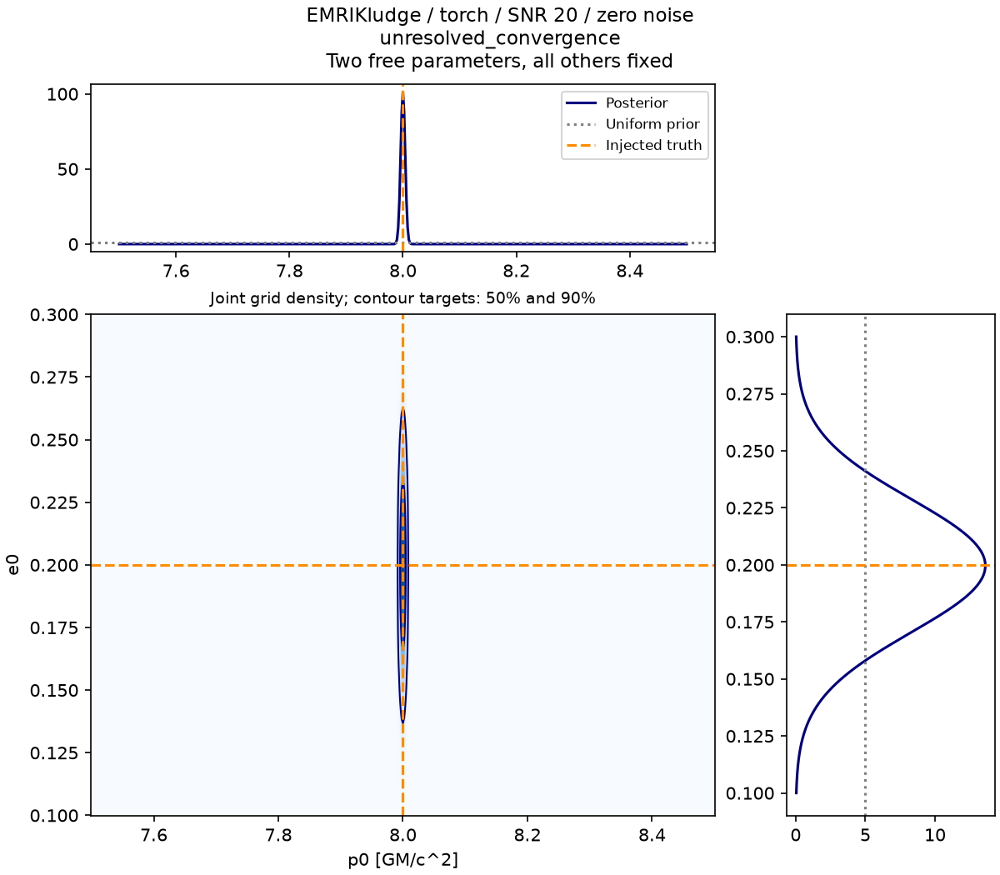

# All-waveform parameter-estimation campaign

This is the **30 September 2026 historical grid study**. All 58 declared
frontend/route outcomes were recorded: 36 converged baselines, 20 unresolved
results and two component-only blockers. Recording every outcome does not mean
all experiments passed.

For later reference and sampler evidence, see the [current PE results](parameter-estimation-results.md).
The historical outcomes below remain unchanged. This study tests bounded
same-model numerical recovery; it supplies no full-dimensional, ensemble
calibration or independent physical-accuracy claim. The
[protocol](../inference.md#parameter-estimation-campaign) explains the checks.

## Coverage and claim

The frozen executed `scripts/qualification/pe_cases.py` inventory covers 19 canonical
dispatcher entries (15 frequency-domain
and four time-domain), three additional distinct dispatcher routes, and six
specialized waveform/API scopes: 28 scopes in total. A separate TEOB Hamiltonian
component row is blocked because it supplies no public waveform; substituting
another EOB model would change the claim. All 29 rows cover both Torch and JAX:
56 executed waveform/API experiments and
two explicitly blocked component experiments.

| Case IDs | Route and two free axes |
| --- | --- |
| `TaylorF2`, `TaylorF2_HM`, `IMRPhenomD`, `IMRPhenomHM`, `IMRPhenomXAS`, `IMRPhenomXHM` | FD dispatcher; component masses |
| `TaylorF2_Eccentric` | FD dispatcher; primary mass and reference eccentricity |
| `IMRPhenomD_NRTidal`, `IMRPhenomD_NRTidalv2`, `IMRPhenomNSBH` | FD dispatcher; component masses, fixed tidal parameters |
| `IMRPhenomP`, `IMRPhenomXP`, `IMRPhenomXPHM` | FD dispatcher; component masses, fixed precessing spins |
| `IMRPhenomPv2`, `IMRPhenomXPHMSpinTaylor`, `IMRPhenomXPNR` | Additional distinct FD dispatcher routes; component masses |
| `IMRPhenomT`, `IMRPhenomTHM`, `IMRPhenomTP`, `IMRPhenomTPHM` | TD dispatcher with fixed FFT adapter; component masses; TP/TPHM select `nnlo` |
| `KerrRingdown`, `KerrRingdownDirect` | FD dispatcher and separate direct class; final mass and spin |
| `SEOBNRv4_ROM` | Cached native public ROM class with dispatcher-equivalent default options; component masses; required checksum-validated external ROM asset |
| `ParameterizedPostEinstein` | Direct FD class; primary mass and phase deformation `beta_ppe`, fixed exponent |
| `EMRIKludge`, `NewtonianEccentricEMRI` | Native source polarizations with fixed FFT adapter; `p0` and `e0` |
| `ContinuousWave` | Native detector strains with fixed FFT adapter; `f0` and `f1` |
| `MemoryWaveform` | Native memory from IMRPhenomTHM physical `(2,2)` modes with fixed FFT adapter; carrier component masses |
| `TEOBResumSHamiltonian` | Component-only row; blocked, no public waveform |

The executed inventory freezes numerical prior bounds, injection truth,
options and fixed parameters. Alias spellings are not additional cases. The
memory adapter supplies native `h22` rather than fitting an arbitrary amplitude;
its carrier accuracy remains a separate qualification question. One selected
option tuple cannot qualify every version or a whole family.

Initial self-injections can establish numerical posterior recovery and pipeline
consistency in their declared scope. They do not establish independent physical
accuracy, population coverage or full-dimensional PE. Existing mathematical,
binary and physical failures retain their original status. Independent physical
injections and calibrated prior-drawn ensembles require separate campaigns.

Each frontend generates its own injection and fixed SNR scale. Comparing their
self-injection outcomes therefore does not establish common-data frontend parity.
The maintained regression suite separately checks IMRPhenomD likelihoods at
fixed candidate points with shared injection data and PSDs; this is a
representative check, not a campaign-wide posterior-parity result.

## Frozen initial experiment

The initial campaign uses protocol v2, CPU FP64, zero noise, target SNR 20 and
uniform bounded native priors in the two listed parameters, with every other
parameter fixed. It declares 31, 61, 121, 241 and 481 nodes per axis before
full-campaign execution and stops at the first adjacent-grid comparison that
passes the [numerical gates](../inference.md#accept-a-bounded-posterior-result).
It retains the original prior when a boundary or informativeness diagnostic is
flagged. CDF and mean drift are recorded diagnostics, not additional pass gates.
Protocol v2 adds joint-density total variation at most 0.05 to detect transverse
ridge underresolution that the v1 marginal checks missed. The v1 pilot remains
a separately retained preflight, not a completed v2 campaign result.
The subsequent v2 IMRPhenomD pilot did not meet the joint-density gate by 121
nodes per axis. The schedule was therefore extended to 241 and 481 before the
full campaign, retaining every prior, waveform option and numerical threshold.
The pilot remains diagnostic evidence of underresolution rather than a final
campaign outcome.

Ground-detector cases use native H1/L1 projection and analytical aLIGO PSDs.
EMRI cases instead use synthetic plus/cross channels and flat PSD weighting;
these do not model a LISA/TDI instrument. Continuous-wave cases already return
native detector strains. TD adapters use the same fixed window, sampling grid,
Fourier normalization and frequency mask for every candidate and injection.

## Reproducibility

The compact receipts identify the original source, case options, priors,
precision, numerical adapters and retained data. Compilation and batching
choices do not change the frozen likelihood or acceptance gates. Historical
self-injections remain separate in each frontend; they are not a common-data
parity experiment.

### Executed source

| Record | SHA256 |
| --- | --- |
| Executed Python source digest, as recorded by the runner | `fb6d1e0f72733e9f4336dfb5e8f35a7b74185f3aafa30ef63488896480090aed` |
| Retained original `source-final.tar.gz` archive | `202d2338a4584092d29963453720b3c76ea2f0a416772c9a6ea7eb9937016c5f` |

The source digest binds the executed `src` Python files, runner and inventory;
the archive hash identifies the original snapshot that produced these results.
The [reproduction manifest](parameter-estimation-20260930-execution.json)
binds the source archives, runtime versions, verified ROM asset, numerical
configuration and retained outputs. Per-row elapsed times describe individual
final attempts, rather than total campaign wall time.

### Numerical outcomes

The [final compact receipt](parameter-estimation-20260930.json) contains
36 `completed_grid_baseline`, 20 `unresolved_convergence` and two `blocked`
outcomes across all 58 intended frontend/route combinations. Each frontend has
18 completed baselines, ten unresolved results and one component blocker.
Every final row has a recorded outcome; unresolved integration is distinct from
a failed execution. The receipt is 352,115
bytes, SHA256
`b871b973bd54368ebfce6c5aa95e497328839039dae8eb86551a263f082ebe80`.
The original receipts and retained arrays are hash-bound; previous failed
execution proofs and attempts remain separate evidence.

Each frontend cell gives **outcome / largest completed grid / final joint TV**.
`C` means `completed_grid_baseline`, `U` means `unresolved_convergence`,
`B` means blocked. Grid size is nodes per axis;
TV is rounded to five decimals. Prior flags are reported separately below.

| Case ID | Torch | JAX |
| --- | --- | --- |
| `TaylorF2` | C / 481 / 0.03547 | C / 481 / 0.03547 |
| `TaylorF2_HM` | C / 481 / 0.03629 | C / 481 / 0.03629 |
| `IMRPhenomD` | C / 481 / 0.02723 | C / 481 / 0.02723 |
| `IMRPhenomHM` | C / 481 / 0.02737 | C / 481 / 0.02737 |
| `IMRPhenomXAS` | C / 481 / 0.02876 | C / 481 / 0.02876 |
| `IMRPhenomXHM` | C / 481 / 0.02627 | C / 481 / 0.02627 |
| `TaylorF2_Eccentric` | C / 241 / 0.03537 | C / 241 / 0.03537 |
| `IMRPhenomD_NRTidal` | U / 481 / 0.46619 | U / 481 / 0.46619 |
| `IMRPhenomD_NRTidalv2` | U / 481 / 0.46617 | U / 481 / 0.46617 |
| `IMRPhenomNSBH` | U / 481 / 0.65849 | U / 481 / 0.65849 |
| `IMRPhenomP` | C / 481 / 0.02716 | C / 481 / 0.02716 |
| `IMRPhenomXP` | C / 481 / 0.02858 | C / 481 / 0.02858 |
| `IMRPhenomXPHM` | C / 481 / 0.02604 | C / 481 / 0.02604 |
| `IMRPhenomPv2` | C / 241 / 0.00564 | C / 241 / 0.00564 |
| `IMRPhenomXPHMSpinTaylor` | U / 481 / 0.02815 | U / 481 / 0.02815 |
| `IMRPhenomXPNR` | C / 481 / 0.02836 | C / 481 / 0.02836 |
| `IMRPhenomT` | U / 481 / 0.18524 | U / 481 / 0.18524 |
| `IMRPhenomTHM` | U / 481 / 0.18649 | U / 481 / 0.18649 |
| `IMRPhenomTP` | U / 481 / 0.18579 | U / 481 / 0.18579 |
| `IMRPhenomTPHM` | U / 481 / 0.18694 | U / 481 / 0.18694 |
| `KerrRingdown` | C / 121 / 0.01718 | C / 121 / 0.01718 |
| `KerrRingdownDirect` | C / 121 / 0.01503 | C / 121 / 0.01503 |
| `SEOBNRv4_ROM` | C / 481 / 0.02589 | C / 481 / 0.02589 |
| `ParameterizedPostEinstein` | C / 481 / 0.00953 | C / 481 / 0.00953 |
| `EMRIKludge` | U / 481 / 0.03533 | U / 481 / 0.03533 |
| `NewtonianEccentricEMRI` | C / 121 / 0.01688 | C / 121 / 0.01688 |
| `ContinuousWave` | U / 481 / 0.20131 | U / 481 / 0.20131 |
| `MemoryWaveform` | C / 61 / 0.00072 | C / 61 / 0.00072 |
| `TEOBResumSHamiltonian` | B / — / — | B / — / — |

The unresolved results all reach the declared maximum of 481 nodes per axis:

| Routes | Remaining failed gate, in both frontends unless stated |
| --- | --- |
| T/THM/TP/TPHM | Joint TV, about 0.185–0.187 |
| D_NRTidal/D_NRTidalv2/NSBH | Joint TV, about 0.466/0.466/0.658 |
| XPHMSpinTaylor | `mass2` 90% width drift, about 0.0646, despite joint TV passing |
| EMRIKludge | `p0` quantile drift about 0.0617 of the final 90% width and relative width drift about 0.1224, despite joint TV passing |
| ContinuousWave | Joint TV, about 0.201 |

Every available final marginal 90% interval spans at least four fine-grid
intervals, including the unresolved results. EMRIKludge's `p0` spans about 6.52
and XPHMSpinTaylor's `mass2` about 8.50. Passing marginal resolution or TV alone
therefore cannot replace the complete frozen gate set. Near-identical rounded
frontend metrics remain separate self-injection results, not common-data parity.

The largest completed grid is distinct from the requested maximum or an
interrupted attempt. A failed receipt may retain an earlier converged grid;
the execution outcome still remains `failed`. The compact results record retains
the final comparison's full failure list, measured SNR, execution strategy,
fallback/error and hash-linked original receipt. Counts and tables must refer
to the same frozen source and protocol, without mixing pilot receipts or
duplicating partition outputs.

A case unresolved at 481 nodes per axis remains unresolved under this frozen
schedule. Waveform/likelihood failures and persistence/reporting failures are
distinct; an artifact error does not silently become a successful campaign
outcome.

### Prior and interval diagnostics

The final receipt flags 34 frontend/route results as prior-support limited
(36 axes), and ten axes as prior dominated; no joint posterior is prior
dominated under the frozen convention. These flags do not change the numerical
outcomes above. Both frontends have the following flags.

| Routes | Flagged axes |
| --- | --- |
| D/HM/XAS/XP/XPNR, T/THM/TP/TPHM | `mass1`: prior-support limited |
| TaylorF2_Eccentric | `e0`: prior-support limited and prior dominated |
| D_NRTidal/D_NRTidalv2, SEOBNRv4_ROM | `mass1`: prior-support limited and prior dominated |
| KerrRingdown/KerrRingdownDirect | `final_spin`: prior-support limited |
| ParameterizedPostEinstein | `beta_ppe`: prior-support limited and prior dominated |
| MemoryWaveform | Both component masses: prior-support limited |

All 112 measured marginal 90% intervals contain their injected truth,
including the unresolved grids. This descriptive inclusion is neither a
numerical pass nor ensemble coverage. In particular, converged eccentric and
ppE experiments can retain a prior-dominated free dimension. Among the
numerically completed results, all 72 marginal intervals contain the truth;
neither count establishes ensemble coverage.

For each free axis, the compact record retains its name, injection truth, frozen bounds, mean,
standard deviation, joint-mode coordinate, 5%/50%/95% quantiles, truth CDF,
low/high boundary mass, KL divergence and prior flags. Also retain joint KL
and its prior-dominance flag. Report which dimensions remain prior limited or
poorly identified, including among numerically completed experiments.
Interval inclusion and agreement of separate self-injections supply no
physical-accuracy or ensemble-calibration promotion.

## Figures and artifacts

The following five figures are selected from the retained 169-figure bundle.
They use SNR 20, zero noise and the frozen two-parameter priors; all other
parameters remain fixed. They supply no physical-accuracy or
ensemble-calibration claim.

Both frontends' recovered medians and marginal 90% intervals, normalized by each
axis's frozen prior width. Hollow markers retain the 20 unresolved outcomes;
the two component blockers supply no posterior and are excluded from this plot.
The free-axis names vary by route. Overlapping frontend self-injections do not
establish common-data posterior parity or physical accuracy.

Torch IMRPhenomD component-mass posterior on the final 481-by-481 grid:
`completed_grid_baseline`. The correlated ridge and marginal densities belong
to the declared bounded prior, with spins and all other parameters fixed.

Torch IMRPhenomD refinement through 481 nodes per axis. The final adjacent-grid
comparison meets all protocol-v2 gates; the figure displays only log-normalizer
and joint-TV diagnostics. The earlier near-stable normalizer alone did not
establish joint convergence.

Torch IMRPhenomD_NRTidal component-mass posterior on the final 481-by-481 grid:
`unresolved_convergence`, with fixed tidal parameters. Joint TV remains about
0.466, above 0.05, despite stable normalization and marginal summaries. The
high TV shows that the joint density along this thin mass ridge remains
underresolved. This self-injection experiment does not measure physical-model
bias.

Torch EMRIKludge `p0`/`e0` posterior on the final 481-by-481 grid:
`unresolved_convergence`, using synthetic plus/cross channels and flat PSDs
rather than a LISA/TDI response. Joint TV is about 0.035 and passes, but the
`p0` quantile drift is about 0.062 of the final 90% width and relative width
drift is about 0.122; both exceed 0.05. The apparent smoothness of this plot
therefore does not establish numerical convergence. Other source parameters
remain fixed.

A P-P plot belongs only to an executed, appropriately generated calibration
ensemble.

The compact receipt links original receipts and retained grid/signal arrays
with their actual locations, SHA256 and byte sizes. Maintained scripts/configs,
compact receipts and these five figures accompany this report; bulk arrays, the
full figure collection and reproduction records are retained externally. The original source archive and
actual executor configurations define reproduction of the executed experiment.

Retained bundles are identified as `parameter-estimation-results.tar.gz`,
`parameter-estimation-figures.tar.gz` and
`parameter-estimation-reproduction.tar.gz`. The
[execution manifest](parameter-estimation-20260930-execution.json) binds their
hashes and reproduction settings. The 169-figure collection is retained
externally; this page includes five selected figures. These identifiers do not
imply a separately published bulk download. Reproduction must use the frozen
source archives and original configuration, rather than assuming that a later
checkout produced the historical results.
